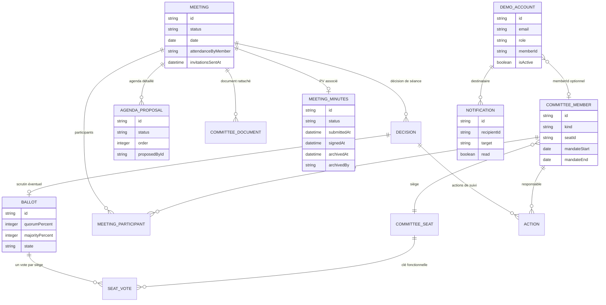
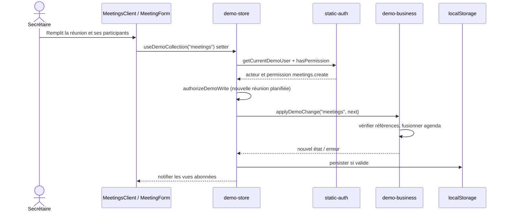
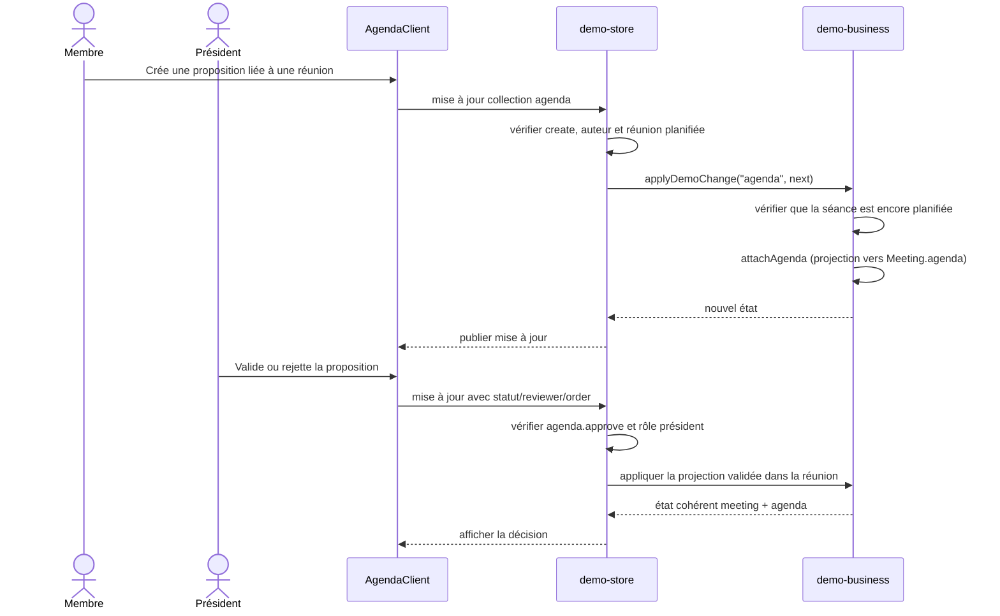
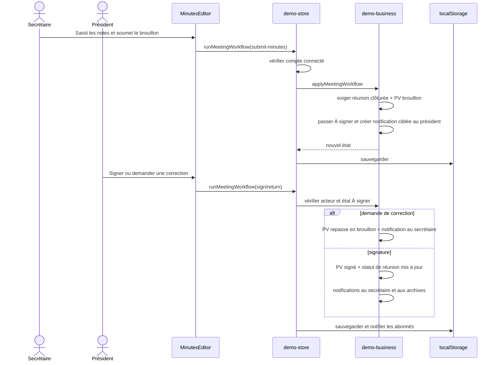
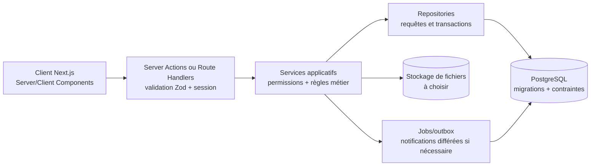

# Architecture technique — Gestion du comité scientifique

Cette documentation décrit le frontend et ses données de démonstration. La couche de persistance est décrite dans le [guide BDD](./database/GUIDE_BDD.md).

> **Branche observée :** `feat/integration-bdd`
> **Application actuelle :** frontend Next.js et données fictives dans le navigateur  
> **Couche de données** — PostgreSQL et Prisma sont opérationnels. L’interface utilise encore les fixtures du navigateur.

## 1. Présentation générale

Le dépôt est une application Next.js utilisant l’App Router, React et TypeScript. L’interface réutilise le layout Shadboard et des composants shadcn/ui. Les pages métier sont localisées (`/fr`, `/en`, `/ar`) et s’appuient sur des clients React rangés par fonctionnalité sous `src/features/`.

Les données actuelles sont de démonstration. Les fichiers `mock-data.ts` initialisent les collections; `src/lib/demo-store.ts` tient l’état courant en mémoire et le sauvegarde dans `localStorage`. Les changements passent par des contrôles d’accès puis par `src/lib/demo-business.ts`, qui applique les règles de cohérence et les effets métier locaux.

Le dépôt contient le schéma PostgreSQL, les migrations et le client Prisma. Le raccordement des routes métier reste à développer. Le [guide d’installation](./setup.md) couvre la configuration locale.

### Pile observée

| Domaine | Technologie/fichiers |
|---|---|
| Framework et routage | Next.js App Router; routes sous `src/app/[lang]/`. |
| UI | React, TypeScript, Tailwind CSS, composants Shadboard et shadcn/ui. |
| Interaction | Hooks React, Radix UI, `lucide-react`. |
| Authentification actuelle | `src/lib/static-auth.ts`; comptes statiques et stockage navigateur. |
| Données actuelles | Types et `mock-data.ts` par module, store commun dans `src/lib/demo-store.ts`. |
| Règles métier actuelles | Fonctions synchrones dans `src/lib/demo-business.ts`; algorithmes spécialisés dans les `utils.ts` des modules. |
| Langues | Français, anglais, arabe avec direction RTL. |
| Tests/QA | `qa/audit-statique.cjs`, Playwright dans `qa/e2e/committee.spec.ts`, configuration `qa/playwright.config.ts`. |
| Dépendances de données serveur | PostgreSQL 18.7 et Prisma ORM 7.10.1. Le singleton Prisma est disponible côté serveur. |

## 2. Schéma des couches actuelles

```mermaid
flowchart TD
  B[ navigateur ]
  M[src/middleware.ts\nlocale + cookie demo-auth]
  L[src/app/[lang]/layout.tsx\nproviders + thème + direction]
  DL[src/app/[lang]/(dashboard-layout)/layout.tsx\nStaticAuthGuard + layout Shadboard]
  R[Routes App Router\nune page par espace métier]
  C[Clients React des modules\nformulaires · listes · dialogs · panneaux]
  PERM[src/lib/static-auth.ts\nsession + matrice de permissions]
  STORE[src/lib/demo-store.ts\nétat partagé + validation + persistance]
  BIZ[src/lib/demo-business.ts\ntransitions + règles + synchronisations]
  MOCK[types.ts + mock-data.ts\nmodèles/fixtures par module]
  LS[(localStorage\nsession · comptes · demo-data)]
  UI[Shadboard + shadcn/ui\ncomposants partagés + CSS]

  B --> M --> L --> DL --> R --> C
  DL --> PERM
  C --> PERM
  C --> STORE
  STORE --> PERM
  STORE --> BIZ
  BIZ <--> MOCK
  STORE <--> LS
  PERM <--> LS
  R --> UI
  C --> UI
```

**Lecture du schéma :** le navigateur charge une route localisée. Le middleware gère la locale et une première redirection de session. Le layout privé applique le garde React. Les composants de page appellent le store local; celui-ci vérifie les droits et délègue la cohérence métier avant de notifier les abonnés et d’écrire dans `localStorage`.

## 3. Arborescence commentée

```text
.
├── src/
│   ├── app/
│   │   ├── [lang]/
│   │   │   ├── layout.tsx                     # Layout localisé, Providers, lang/dir, toasts
│   │   │   ├── sign-in/page.tsx               # Connexion de démonstration
│   │   │   └── (dashboard-layout)/
│   │   │       ├── layout.tsx                 # Auth guard et layout principal
│   │   │       ├── dashboards/analytics/      # Tableau de bord
│   │   │       ├── meetings/                  # Page Réunions
│   │   │       ├── members/                   # Page Membres
│   │   │       ├── agenda/                    # Page Ordre du jour
│   │   │       ├── votes/                     # Page Votes et résultats
│   │   │       ├── actions/                   # Décisions et actions
│   │   │       ├── documents/                 # Documents, PV, Archives
│   │   │       ├── notifications/             # Centre de notifications
│   │   │       ├── profile/                   # Profil connecté
│   │   │       └── users/                     # Comptes fictifs
│   │   ├── globals.css                        # Styles globaux, Tailwind
│   │   └── themes.css                         # Variables et thèmes
│   ├── components/
│   │   ├── auth/                              # Connexion et garde de routes
│   │   ├── committee-ui/                      # Enveloppe et styles métier du comité
│   │   ├── layout/                            # Layout Shadboard, nav, cloche, menus
│   │   └── ui/                                # Primitives graphiques réutilisables
│   ├── configs/                               # Configuration i18n et thèmes
│   ├── contexts/                              # Préférences utilisateur (locale, etc.)
│   ├── data/
│   │   ├── dictionaries/{fr,en,ar}.json       # Dictionnaires du shell
│   │   └── navigations.ts                     # Navigation déclarative
│   ├── features/                              # Fonctionnalités métier par domaine
│   │   ├── agenda/
│   │   ├── dashboard/
│   │   ├── decisions/
│   │   ├── documents/
│   │   ├── meetings/
│   │   ├── members/
│   │   ├── notifications/
│   │   ├── profile/
│   │   ├── users/
│   │   ├── votes/
│   │   └── ui-text.ts                         # Textes UI de modules
│   ├── hooks/                                 # Hooks partagés, responsive, RTL, thème
│   ├── lib/
│   │   ├── demo-store.ts                      # Store et persistance navigateur
│   │   ├── demo-business.ts                   # Moteur de règles métier local
│   │   ├── static-auth.ts                     # Authentification/permissions fictives
│   │   ├── i18n.ts, get-dictionary.ts          # Routage et chargement de langues
│   │   └── utils.ts                           # Utilitaires partagés
│   ├── providers/                             # Settings, thème, mode, direction, sidebar
│   ├── schemas/                               # Schémas de formulaires partagés
│   └── types.ts                               # Types globaux, dont locale/direction
├── qa/
│   ├── audit-statique.cjs                     # Audit statique des pages/imports
│   ├── playwright.config.ts                   # Configuration des tests navigateur
│   ├── e2e/committee.spec.ts                   # Scénarios Playwright
│   └── CHECKLIST.md                            # Checklist QA
├── prisma/                                    # Schéma Prisma, migrations et seed
├── docs/setup.md                              # Guide d’installation
└── package.json                                # Scripts et dépendances frontend
```

Les composants génériques de `src/components/ui/` sont des briques de présentation. Pour une fonctionnalité métier, commencer par `src/features/<module>/` plutôt que modifier ces primitives globales.

## 4. Pages, URLs et modules

Les segments `[lang]` et `(dashboard-layout)` sont des conventions App Router : `[lang]` fait partie de l’URL; le groupe entre parenthèses n’y apparaît pas. Le middleware ajoute une langue lorsqu’elle manque.

| Espace | URL localisée | Fichier de route | Dossier fonctionnel / client |
|---|---|---|---|
| Connexion | `/{lang}/sign-in` | `src/app/[lang]/sign-in/page.tsx` | `src/components/auth/static-sign-in.tsx` |
| Tableau de bord | `/{lang}/dashboards/analytics` | `src/app/[lang]/(dashboard-layout)/dashboards/analytics/page.tsx` | `src/features/dashboard/` |
| Réunions | `/{lang}/meetings` | `src/app/[lang]/(dashboard-layout)/meetings/page.tsx` | `src/features/meetings/` |
| Membres | `/{lang}/members` | `src/app/[lang]/(dashboard-layout)/members/page.tsx` | `src/features/members/` |
| Ordre du jour | `/{lang}/agenda` | `src/app/[lang]/(dashboard-layout)/agenda/page.tsx` | `src/features/agenda/` |
| Votes et résultats | `/{lang}/votes` | `src/app/[lang]/(dashboard-layout)/votes/page.tsx` | `src/features/votes/` |
| Décisions et actions | `/{lang}/actions` | `src/app/[lang]/(dashboard-layout)/actions/page.tsx` | `src/features/decisions/` |
| Documents / PV / Archives | `/{lang}/documents` | `src/app/[lang]/(dashboard-layout)/documents/page.tsx` | `src/features/documents/` |
| Notifications | `/{lang}/notifications` | `src/app/[lang]/(dashboard-layout)/notifications/page.tsx` | `src/features/notifications/` |
| Profil | `/{lang}/profile` | `src/app/[lang]/(dashboard-layout)/profile/page.tsx` | `src/features/profile/` |
| Utilisateurs | `/{lang}/users` | `src/app/[lang]/(dashboard-layout)/users/page.tsx` | `src/features/users/` |

`{lang}` vaut `fr`, `en` ou `ar`. Les routes privées partagent le layout du tableau de bord; la page Utilisateurs n’est visible qu’aux comptes ayant la permission correspondante.

## 5. Fichiers métier importants par module

Convention générale :

- `*-client.tsx` compose l’écran et gère ses interactions locales;
- `*-form.tsx`, `*-details.tsx`, `*-panel.tsx` isolent les formulaires, détails et sous-vues;
- `types.ts` décrit les objets métier;
- `mock-data.ts` fournit l’état initial fictif;
- `utils.ts` contient des calculs purs propres au domaine;
- les modifications partagées doivent utiliser `demo-store.ts`, pas un `useState` indépendant.

### Réunions — `src/features/meetings/`

| Fichier | Responsabilité |
|---|---|
| `meetings-client.tsx` | Liste/calendrier, sélection, ouverture des détails, création et édition. Utilise les collections du store. |
| `meeting-details.tsx` | Détail de séance, participants, feuille de présence, actions de workflow et appels `runMeetingWorkflow`, `sendMeetingInvitationsFromStore`, `createMeetingMinutes`. |
| `meeting-form.tsx` | Création/édition des informations générales, participants et points liés à la séance. |
| `meeting-calendar.tsx` | Présentation calendrier des réunions. |
| `types.ts` | `Meeting`, états, participants, présence et données de workflow. |
| `mock-data.ts` | Réunions et membres de démonstration utilisés par ce domaine. |

### Membres — `src/features/members/`

| Fichier | Responsabilité |
|---|---|
| `members-client.tsx` | Annuaire, filtres, sélection et actions autorisées. |
| `member-form.tsx`, `member-details.tsx` | Formulaire et fiche membre. |
| `seats-panel.tsx` | Visualisation des sièges, titulaires et suppléants. |
| `types.ts` | `CommitteeMemberRecord`, `CommitteeSeat`, fonction, type, siège et période de mandat. |
| `utils.ts` | `mandateStatus`, chevauchement et validation des périodes/sièges. |
| `mock-data.ts` | Membres initiaux et `committeeSeats`. |

### Ordre du jour — `src/features/agenda/`

| Fichier | Responsabilité |
|---|---|
| `agenda-client.tsx` | Liste des propositions, choix de réunion, création, édition, validation/rejet par le président et réordonnancement. |
| `agenda-form.tsx`, `agenda-details.tsx` | Saisie, détails, notes de revue et pièces jointes de proposition. |
| `types.ts` | `AgendaProposal`, statut et attachements. |
| `utils.ts` | Tri, déplacement des points validés, étiquettes et téléchargement. |
| `mock-data.ts` | Propositions initiales. |

La collection `agenda` est la source détaillée des propositions. `demo-business.ts` projette les propositions non rejetées dans `Meeting.agenda` et les resynchronise après changement.

### Votes — `src/features/votes/`

| Fichier | Responsabilité |
|---|---|
| `votes-client.tsx` | Sélection de scrutin, gestion de présence, vote, création et clôture selon droits. |
| `ballot-panel.tsx` | Représentation des sièges, membres éligibles et saisie des votes. |
| `create-ballot-dialog.tsx` | Création du scrutin et configuration du quorum/de la majorité. |
| `results-panel.tsx` | Résultats calculés et indicateurs de quorum/participation. |
| `types.ts` | `BallotSession`, `SeatVote`, `SeatRepresentation`, `BallotSummary`. Un vote est indexé par siège. |
| `utils.ts` | `activeOnDate`, `seatRepresentations`, `calculateBallot`, `removeStaleVotes`, `outcomeLabel`. C’est la logique de calcul de référence du vote. |
| `mock-data.ts` | Scrutins initiaux. |

### Décisions et actions — `src/features/decisions/`

| Fichier | Responsabilité |
|---|---|
| `decisions-actions-client.tsx` | Écran combiné de décisions et de suivi des actions; liens aux réunions, scrutins et responsables. |
| `decision-form.tsx`, `action-form.tsx` | Formulaires de décision et d’action. |
| `actions-kanban.tsx` | Vue kanban des actions. |
| `types.ts` | `DecisionRecord`, `ActionRecord`, statuts et métadonnées d’archivage. |
| `utils.ts` | Références, dates, échéances et réorganisation d’actions. |
| `mock-data.ts` | Décisions et actions initiales; les actions pointent vers une décision par `decisionId`. |

### Documents et procès-verbaux — `src/features/documents/`

| Fichier | Responsabilité |
|---|---|
| `documents-client.tsx` | Bibliothèque, espace PV, Archives, filtres et liens aux réunions/décisions. |
| `document-form.tsx`, `document-details.tsx` | Saisie/consultation d’un document, versions et pièce jointe locale. |
| `minutes-editor.tsx` | Notes du secrétaire, soumission, corrections, signature simulée et archivage. |
| `minutes-preview.tsx` | Aperçu structuré, alimenté par réunion, participants, agenda, décisions, votes et actions disponibles. |
| `types.ts` | `CommitteeDocument`, `DocumentVersion`, `MeetingMinutes`, catégories et statuts. |
| `utils.ts` | Dates, identifiants, étiquettes, échappement HTML et impression du PV par la fenêtre navigateur. |
| `mock-data.ts` | Documents et PV initiaux. |

L’archivage modifie le statut métier et ajoute une date/identité d’archivage. Il n’est pas équivalent à la signature. Le contenu des objets `File` ne persiste pas dans `localStorage`.

### Notifications — `src/features/notifications/`

| Fichier | Responsabilité |
|---|---|
| `notifications-client.tsx` | Centre, filtres et actions de lecture/archivage. |
| `notification-details.tsx`, `notification-icon.tsx` | Détail et choix visuel par type. |
| `notification-simulator.tsx` | Outil local de simulation d’une notification. |
| `types.ts` | Types d’événement, priorité, destinataire, lecture et route cible. |
| `utils.ts` | Labels, filtre, total non lu et création d’exemples. |
| `mock-data.ts` | Notifications de démarrage. |
| `src/components/layout/notification-dropdown.tsx` | Cloche et liste rapide dans le layout global. |

### Tableau de bord, comptes et profil

| Dossier/fichier | Responsabilité |
|---|---|
| `src/features/dashboard/dashboard-overview.tsx` | Écran du tableau de bord et composition des widgets. |
| `src/features/dashboard/dashboard-data.ts` | Données et agrégats du tableau de bord. |
| `src/features/users/users-client.tsx`, `user-text.ts` | Gestion des comptes de démonstration. Comptes et membres sont des entités distinctes; les comptes non-admin doivent être liés à un membre et à son siège, tandis que le rôle de connexion reste porté par le compte. |
| `src/features/profile/profile-client.tsx` | Informations locales du profil connecté. |

Le tableau de bord lit les collections partagées via `useDemoData()`. Ses indicateurs de réunions, membres actifs, décisions et actions sont calculés depuis ces données, et ses notifications sont filtrées par identifiant du compte connecté (les comptes administrateurs ne voient donc pas automatiquement les notifications des autres acteurs).

## 6. Fichiers centraux : responsabilités approfondies

### `src/lib/static-auth.ts` — identité et permissions fictives

Ce module côté client ne contacte aucun fournisseur d’identité.

- **Types :** `DemoRole`, `DemoUser`, `DemoAccount`, `Permission`.
- **Comptes :** `demoAccounts` fournit les comptes intégrés. `getDemoAccounts()` relit les comptes surchargés depuis `localStorage` et prend en charge quelques comptes de migration.
- **Session :** `signInStatic(email, password)` vérifie le compte actif, écrit l’utilisateur courant et pose le cookie `demo-auth`; `signOutStatic()` efface la session; `useStaticAuth()` expose l’utilisateur avec `useSyncExternalStore`.
- **Administration locale :** `saveDemoAccounts(accounts, members?)` vérifie le rôle admin, l’existence d’au moins un admin actif, l’unicité e-mail/membre et la présence des comptes intégrés. Lorsqu’une liste de membres est fournie, chaque compte non-admin doit référencer un membre existant et le siège correspondant.
- **Correspondance siège-compte :** `syncDemoAccountSeats(members)` recalcule le siège des comptes associés à un membre après une modification des membres et met à jour le snapshot de session courant.
- **Permissions :** `rolePermissions` associe rôles et modules. `hasPermission(user, module, permission)` est utilisé par les écrans et le store. `moduleForPath(pathname)` convertit une route en module pour le garde.
- **Limite :** le cookie et `localStorage` sont modifiables par le client; ce n’est pas une frontière de sécurité pour une application déployée.

### `src/lib/demo-store.ts` — source d’état réactive et persistance

- **État initial :** importe les `initial*` depuis les modules et compose `DemoState` en une seule structure. La forme du type `DemoState` est définie dans `demo-business.ts`.
- **Hydratation :** `initialize()` lit la clé `comite-scientifique:demo-data:v1`, restaure collection par collection et utilise les valeurs initiales pour les collections absentes/invalides.
- **Persistance :** `persist()` sérialise l’état dans `localStorage`. Son replacer omet les clés `file`, car les objets `File` ne sont pas sérialisables.
- **Abonnement :** `useDemoData()` expose le snapshot complet; `useDemoCollection(key)` expose une collection et son setter. Ces hooks reposent sur `useSyncExternalStore` et publient les changements aux composants abonnés.
- **Écriture d’une collection :** le setter résout la mise à jour immuable, obtient l’acteur courant, appelle `authorizeDemoWrite()`, puis `applyDemoChange()`. En cas de succès il remplace le snapshot, persiste et notifie; en cas de refus il conserve les données et publie un message via `useDemoFeedback()`. Après une mise à jour des membres, il synchronise aussi les sièges des comptes avant d’accepter l’écriture.
- **Autorisations par collection :** la fonction locale `authorizeDemoWrite()` contrôle membres, réunions, agenda, scrutins, décisions, actions, documents, PV et notifications. Elle applique des restrictions plus fines que le simple accès à la page, notamment état de réunion, auteur d’une proposition, attribution d’action et destinataire de notification.
- **Entrées métier spécialisées :** `runMeetingWorkflow()`, `sendMeetingInvitationsFromStore()` et `createMeetingMinutes()` vérifient que l’acteur transmis correspond au compte connecté, puis appliquent les transitions prévues et sauvegardent.
- **Réinitialisation :** `resetDemoData()` est réservée au compte admin et remplace les collections par leurs fixtures.
- **Limite :** la persistance partage un navigateur, pas des sessions ou appareils entre utilisateurs.

### `src/lib/demo-business.ts` — transitions métier locales

Le module définit `DemoState`, `CollectionKey`, `TransitionResult` et `WorkflowAction`. Ses fonctions reçoivent l’état en argument et retournent un nouvel état ou une erreur; elles n’écrivent ni dans le navigateur ni sur un serveur. Les horodatages et identifiants de notification sont toutefois générés par l’horloge et un compteur du module : les transitions ne sont donc pas strictement pures/déterministes.

- `sendMeetingInvitations(state, meetingId, actor)` accepte le secrétaire et une réunion planifiée, construit une notification par participant ayant un compte démo associé, et date l’envoi.
- `applyMeetingWorkflow(state, action, meetingId, actor, minutesId?)` applique le démarrage/clôture par le président et la soumission, correction ou signature des PV avec contrôle de statut et génération de notifications ciblées.
- `notification()` et `userNotification()` construisent les événements locaux; `withNotifications()` les ajoute aux collections.
- `agendaView()`, `attachAgenda()` et `mergeMeetingAgenda()` maintiennent la projection entre propositions et points d’ordre du jour de la réunion.
- `deletionIssue()` explique pourquoi réunion, membre ou décision référencés ne peuvent pas être supprimés.
- `applyDemoChange(state, key, value, recipients)` gère les mises à jour transversales : intégrité des références, validation des membres/mandats/actions/scrutins, projection réunion↔agenda, synchronisation bidirectionnelle des présences réunion↔scrutins ouverts et présence→brouillons de PV, notifications ciblées et contraintes d’immuabilité.
- Les présences sont limitées aux participants de la réunion. Leur changement recalcule les représentants de siège dans les scrutins ouverts, retire les votes devenus invalides et actualise le brouillon de PV; les scrutins clôturés ne sont pas resynchronisés.
- À la clôture, `closedResult` conserve le résumé historique calculé. `calculateBallot()` le retourne ensuite sans recalcul à partir des mandats actuels; les contrôles d’écriture interdisent de modifier directement la décision liée ou ce snapshot.
- La création d’un scrutin exige une décision en attente; un seul scrutin peut être associé à une décision. Les présences doivent être uniques et limitées aux participants, les votes valides portent la clé d’un siège représenté par le votant, et les seuils de quorum/majorité sont bornés de 1 à 100 %.
- La validation des membres applique `validateMemberSeat()` et empêche les chevauchements de mandat incompatibles, ainsi que la suppression d’un membre encore référencé par un compte ou par des données métier.
- **Limite :** les règles métier sont locales et invoquées par le client; un backend devra refaire ces contrôles côté serveur et gérer les écritures concurrentes en transaction.

### Répartition des responsabilités entre ces trois modules

```text
Interface
  ├─ lecture : useDemoData / useDemoCollection
  ├─ mutation simple : setter de useDemoCollection
  │     └─ demo-store: autoriser → demo-business: appliquer → localStorage
  └─ transition explicite : runMeetingWorkflow / createMeetingMinutes / invitations
        └─ demo-store: vérifier l’acteur → demo-business: transition → localStorage
```

## 7. Modèle métier et relations



`MEETING_PARTICIPANT` est une entité conceptuelle pour expliquer les liens : dans le modèle actuel les identifiants participants sont sur la réunion, et les présences y sont un objet indexé par identifiant membre. De même, `SEAT_VOTE` est un objet `votes` indexé par siège dans `BallotSession`, pas une table persistée.

## 8. Séquences des workflows

### 8.1 Création d’une réunion



### 8.2 Proposition puis validation de l’ordre du jour



### 8.3 Présences et vote

```mermaid
sequenceDiagram
  actor P as Président ou secrétaire
  actor V as Membre autorisé à voter
  participant MD as MeetingDetails
  participant VC as VotesClient
  participant Store as demo-store
  participant Biz as demo-business
  participant Calc as votes/utils
  P->>MD: Renseigne la présence d'un participant
  MD->>Store: Mise à jour Meeting.attendance
  Store->>Store: autoriser uniquement en séance En cours
  Store->>Biz: applyDemoChange("meetings", next)
  Biz->>Biz: propager aux scrutins ouverts de cette réunion
  Biz->>Calc: seatRepresentations + removeStaleVotes
  Calc-->>Biz: représentant actuel par siège; votes devenus invalides retirés
  Biz-->>Store: réunion et scrutins cohérents
  Store-->>VC: publier le nouvel état partagé
  V->>VC: ou modifie la présence depuis Votes et résultats
  VC->>Store: mise à jour des présences du scrutin ouvert
  Store->>Biz: applyDemoChange("ballots", next)
  Biz->>Biz: synchroniser Meeting.attendance et les brouillons de PV
  Biz-->>Store: même état de présence pour cette réunion
  V->>VC: Vote pour/contre/abstention sur son siège éligible
  VC->>Calc: calculateBallot
  Calc-->>VC: quorum, majorité, résultat par siège
  VC->>Store: enregistrer vote sous la clé du siège
  Store->>Store: valider mandat, présence, auteur et scrutin ouvert
```

La collection `Meeting.attendance` et `BallotSession.presentMemberIds` sont les deux représentations de la présence d’une réunion en cours dans les interfaces existantes; `applyDemoChange()` les maintient cohérentes pour les scrutins ouverts de la réunion concernée. Une modification de présence invalide les votes dont le représentant de siège n’est plus éligible. Les actions de présence et de vote sont autorisées séparément afin qu’une mise à jour combinée ne contourne pas les permissions. Les PV brouillons reprennent aussi la liste de présents. Les scrutins clôturés restent des instantanés historiques.

### 8.4 Signature d’un procès-verbal



### 8.5 Archivage

```mermaid
sequenceDiagram
  actor A as Responsable des archives
  participant UI as DocumentsClient / MinutesEditor
  participant Auth as static-auth
  participant Store as demo-store
  participant Biz as demo-business
  participant LS as localStorage
  A->>UI: Demande l'archivage
  UI->>UI: Confirmation avant l'action
  UI->>Auth: hasPermission(documents/minutes, archive)
  Auth-->>UI: permission accordée
  UI->>Store: setter du document, de la décision ou du PV
  Store->>Store: authorizeDemoWrite vérifie acteur et transition permise
  Store->>Biz: applyDemoChange
  Biz->>Biz: contrôle références et cohérence de l'objet
  Note over Store,Biz: Le PV doit déjà être Signé; l'archivage ajoute date et identité
  Biz-->>Store: nouvel état archivé
  Store->>LS: persister
  Store-->>UI: rafraîchir les Archives; l'objet devient en lecture seule
```

## 9. Authentification, rôles et autorisation

| Rôle de connexion | Domaine principal |
|---|---|
| `president` | Révision agenda, démarrage/clôture de séance, présence, gestion des scrutins, signature/correction PV; vote soumis aux règles d’éligibilité. |
| `secretary` | Création/planification, participants, convocations, présence, documents et rédaction/soumission PV; vote soumis à l’éligibilité. |
| `member` | Consultation, proposition de points, actions attribuées et vote lorsque mandat/présence/siège le permettent. |
| `archivist` | Consultation et archivage de documents et PV signés; rôle dédié, sans droits automatiques président/secrétaire. |
| `admin` | Gestion des comptes et membres selon la matrice; n’hérite pas des droits du président ou secrétaire. |

Le type `Suppléant` se trouve dans `CommitteeMemberRecord.kind`; le compte se connecte comme `member`. `seatRepresentations()` dans `src/features/votes/utils.ts` n’accorde le siège au suppléant que si le titulaire actif de ce siège n’est pas présent.

Deux niveaux de contrôle coexistent :

1. **Route/interface :** `StaticAuthGuard` appelle `moduleForPath()` et `hasPermission()`; les pages et actions cachent/désactivent les fonctions hors rôle.
2. **Écriture des données locales :** `authorizeDemoWrite()` contrôle chaque collection et l’état métier avant toute mutation via le store.

Ces mécanismes sont utiles à la maquette et à l’ergonomie, mais doivent être réimplémentés côté serveur pour une application full-stack.

## 10. Internationalisation FR/EN/AR

1. `src/configs/i18n.ts` définit `defaultLocale: "fr"`, `locales: ["fr", "en", "ar"]` et le sens d’écriture (RTL pour l’arabe).
2. `src/middleware.ts` détecte une locale manquante et utilise la préférence navigateur/cookie via `src/lib/i18n.ts` pour rediriger vers une route localisée.
3. `src/app/[lang]/layout.tsx` pose l’attribut `lang` et `dir` du document et transmet ces valeurs aux `Providers`.
4. `src/lib/get-dictionary.ts` et `src/data/dictionaries/{fr,en,ar}.json` chargent les textes du shell et de navigation.
5. `src/features/ui-text.ts` expose `useUiText()` pour les textes d’interface des modules. `src/features/users/user-text.ts` contient les textes propres à l’administration des comptes.
6. `src/providers/direction-provider.tsx` transmet la direction aux composants Radix; le CSS doit utiliser les classes/logiques compatibles RTL.

Les noms, titres, descriptions et contenus saisis sont des données métier : ne pas les passer au traducteur. Seuls les libellés, statuts et messages d’interface doivent changer avec la locale.

## 11. Composants graphiques et design system

- **Shadboard** fournit le cadre d’application : menus latéraux/horizontaux, en-têtes, menu utilisateur, thème et navigation.
- **shadcn/ui / Radix** fournit les primitives dans `src/components/ui/` : `Button`, `Dialog`, `Tabs`, `Select`, `Input`, `Badge`, tables, menus, formulaires, etc. Ces composants sont consommés par les pages sans logique métier.
- **Comité scientifique** : `src/components/committee-ui/committee-shell.tsx` enveloppe les clients métier; `committee-ui.css` contient les adaptations visuelles du comité; `committee-feedback.tsx` affiche les retours du store.
- **Styles** : `src/app/globals.css`, `src/app/themes.css`, Tailwind et les classes utilitaires organisent le thème, l’espacement et le responsive.
- **Icônes** : `lucide-react`; `src/components/dynamic-icon.tsx` permet au menu de résoudre une icône déclarée par nom.

Avant de créer un nouveau composant, chercher une primitive existante dans `src/components/ui/`. Les composants génériques ne devraient pas connaître les réunions, décisions ou rôles métier.

## 12. Guide pratique : où modifier le code ?

| Besoin | Commencer par | Vérifier aussi |
|---|---|---|
| Ajouter une route/page | `src/app/[lang]/(dashboard-layout)/<route>/page.tsx` | `src/data/navigations.ts`, garde et mapping `moduleForPath()`. |
| Ajouter un champ à une réunion | `src/features/meetings/types.ts` et `meeting-form.tsx` | `meetings-client.tsx`, `meeting-details.tsx`, `mock-data.ts`, règles `demo-store.ts`/`demo-business.ts`, traductions. |
| Changer qui peut voir/actionner une page | `src/lib/static-auth.ts` (`rolePermissions`) | `StaticAuthGuard`, boutons/actions du client, `authorizeDemoWrite()` dans le store. |
| Ajouter une permission fine à une mutation | `authorizeDemoWrite()` dans `src/lib/demo-store.ts` | Transition métier correspondante dans `src/lib/demo-business.ts`; messages UI. |
| Ajouter une règle de workflow | `src/lib/demo-business.ts` | Point d’entrée dédié dans `demo-store.ts`, contrôles UI et tests QA. |
| Modifier la connexion ou un rôle | `src/lib/static-auth.ts` | `static-sign-in.tsx`, `users-client.tsx`, garde et routes. |
| Modifier les sièges/suppléants | `src/features/members/types.ts`, `mock-data.ts`, `utils.ts` | `src/features/votes/utils.ts`, panneau de vote et store. |
| Changer le quorum, la majorité ou le résultat | `src/features/votes/types.ts`, `utils.ts` | `votes-client.tsx`, `results-panel.tsx`, règles de vote du store. |
| Modifier l’agenda | `src/features/agenda/` | Projection et synchronisation dans `demo-business.ts`, onglet agenda de réunion. |
| Ajouter un type de document ou un statut | `src/features/documents/types.ts` | Formulaire, filtres, détails, archives, `demo-store.ts`, `demo-business.ts` et traductions. |
| Modifier rédaction, signature ou archivage PV | `minutes-editor.tsx`, `minutes-preview.tsx` | Types documents, transitions de `demo-business.ts`, autorisation dans `demo-store.ts`, notifications. |
| Créer un type de notification | `src/features/notifications/types.ts` | Création dans `demo-business.ts`, filtre/labels dans `notifications/utils.ts`, détail/icône/traductions. |
| Modifier la cloche ou le badge non lu | `src/components/layout/notification-dropdown.tsx` | Centre `notifications-client.tsx`, filtrage destinataire dans le module notifications/store. |
| Ajouter une traduction à un écran | `src/features/ui-text.ts` (ou `user-text.ts` pour utilisateurs) | Conserver les données libres dans leur langue; tester la route `/ar`. |
| Modifier shell/navigation globale | `src/components/layout/` et `src/data/navigations.ts` | Dictionnaires JSON et responsive/RTL. |
| Modifier une primitive visuelle partagée | `src/components/ui/<primitive>.tsx` | Impacts transversaux; si possible, ajuster l’usage dans le client du module plutôt que la primitive. |
| Ajouter une fixture métier | `src/features/<module>/mock-data.ts` | IDs cohérents avec les collections liées et valeurs initiales de `demo-store.ts`. |
| Préparer un test navigateur | `qa/e2e/committee.spec.ts` et `qa/playwright.config.ts` | Comptes, sélecteurs accessibles, isolation et répertoires de résultats QA. |

## 13. Actuelle vs cible full-stack Next.js/PostgreSQL

| Préoccupation | Actuel (implémenté) | Cible proposée (à concevoir et réaliser) |
|---|---|---|
| UI/routage | App Router et clients React localisés. | Conserver App Router; pages serveur possibles et composants interactifs conservés où nécessaire. |
| Identité | Comptes et session statiques côté navigateur; cookie de démonstration. | Authentification serveur avec sessions sécurisées, hachage des mots de passe, expiration/révocation et contrôle d’accès côté serveur. |
| Lecture des données | `useDemoData`/`useDemoCollection`, fixtures et `localStorage`. | Couche repository/service côté serveur lisant PostgreSQL; composants obtiennent les données via Server Components ou appels contrôlés. |
| Écriture | Setter local, permission UI/store, transformation synchrone. | Server Actions ou Route Handlers validés côté serveur; transactions pour opérations multi-entités. |
| Règles métier | Fonctions pures de `demo-business.ts` et `utils.ts`. | Réutiliser les règles indépendantes de l’UI dans des services de domaine côté serveur; ne jamais faire confiance au rôle transmis par le navigateur. |
| Persistance | Une origine/navigateur, sans concurrence interutilisateur. | PostgreSQL avec migrations versionnées, contraintes FK/UNIQUE/CHECK, transactions et sauvegardes. |
| Fichiers | `File` local temporaire, non inclus dans la sérialisation. | Stockage objet ou stockage serveur, métadonnées PostgreSQL, contrôles d’accès et politique de conservation. |
| Notifications | Collections locales ciblées, cloche mise à jour par store. | Notifications persistées par utilisateur; génération transactionnelle/outbox ou jobs si l’envoi externe est introduit plus tard. |
| Audit/archivage | Champs d’archive sur les objets et règles frontend. | Historique/audit serveur append-only, acteur/date, états immuables validés en base et politique de conservation définie. |
| Tests | Script d’audit statique et scénarios Playwright. | Tests unitaires de domaine, intégration DB/migrations, tests d’autorisation serveur, E2E par rôle et pipeline CI. |

### Schéma cible illustrative

Le diagramme illustre la séparation des responsabilités. PostgreSQL et Prisma sont en place. Les Route Handlers et Server Actions métier relèvent de la future [intégration backend](./database/GUIDE_INTEGRATION_BACKEND.md).



### Entités PostgreSQL à étudier

Les noms sont indicatifs. La modélisation doit être validée par l’équipe avant les migrations.

| Entité candidate | Rôle / contraintes à envisager |
|---|---|
| `users`, `roles`, `user_roles` ou rôle direct contrôlé | Comptes, rôles et états actifs; identité indépendante de la session client. |
| `committee_members`, `committee_seats`, `mandates` | Personnes, sièges et périodes; contraintes d’occupation temporelle à préciser. |
| `meetings`, `meeting_participants`, `attendance_records` | Séances et participants; présence par réunion et membre, avec acteur/date de mise à jour si audit voulu. |
| `agenda_items` | Propositions et décisions de revue; lien à réunion, auteur, statut, ordre, reviewer. |
| `documents`, `document_versions`, `file_objects` | Métadonnées séparées du contenu binaire; réunion/point agenda facultatifs; références de stockage. |
| `minutes`, `minutes_events` ou table d’audit | Rédaction, soumission, correction, signature/archivage; timestamps et acteurs distincts. |
| `decisions`, `ballots`, `ballot_votes` | Scrutins et résultat; unicité `(ballot_id, seat_id)` pour empêcher le double vote. |
| `actions` | Attribution, échéance et statut; références à décision et responsable. |
| `notifications` | Destinataire, cible métier, date, état lu/non lu; index sur destinataire et date. |
| `audit_events` | Journal append-only pour opérations sensibles, signatures et archivages. |

## 14. Fichiers à lire en priorité par responsabilité d’équipe

### Responsable base de données

1. `src/features/*/types.ts` et `mock-data.ts` — inventaire de l’état métier existant.
2. `src/lib/demo-business.ts` — références, règles de transitions, suppression et synchronisations.
3. `src/features/votes/utils.ts` — règles précises de quorum, sièges représentés et validité des votes.
4. `src/features/members/types.ts`, `meetings/types.ts`, `agenda/types.ts`, `decisions/types.ts`, `documents/types.ts`, `notifications/types.ts` — champs et relations actuels.
5. [Guide d’installation](./setup.md) — démarrage PostgreSQL, migrations, seed et tests.

Le modèle relationnel, ses contraintes et les migrations sont livrés. La transition des fixtures de l’interface vers les services backend reste à organiser.

### Responsable backend

1. `src/lib/demo-business.ts` — règles à extraire dans les services métier serveur.
2. `src/lib/demo-store.ts` — points d’entrée utilisés par les clients et opérations multi-collections.
3. `src/lib/static-auth.ts` — rôles/permissions qui devront être revérifiés côté serveur et remplacés par sessions sécurisées.
4. `src/features/votes/utils.ts`, `src/features/members/utils.ts`, `src/features/agenda/utils.ts`, `src/features/decisions/utils.ts` — algorithmes domaine à conserver/tester.
5. `src/features/notifications/types.ts` et `src/features/documents/types.ts` — contrats de notification, archivage et fichiers.

**Livrable attendu pour la suite :** API/actions typées, validation serveur, transactions, tests d’autorisation et adaptation des erreurs vers l’UI.

### Responsable intégration

1. `src/app/[lang]/(dashboard-layout)/layout.tsx`, `src/components/auth/static-auth-guard.tsx`, `src/middleware.ts` — frontière navigation/session actuelle.
2. `src/features/*/*-client.tsx` — endroits où les clients utilisent `useDemoCollection` à remplacer derrière un contrat de données.
3. `src/lib/demo-store.ts` — interface de migration du store local vers repository serveur; éviter d’appeler PostgreSQL depuis un composant client.
4. `src/lib/demo-business.ts` — coordination d’écritures distribuées en transactions et gestion de conflits.
5. `src/features/notifications/` et `src/features/documents/` — intégration ciblée, pièces jointes et fichiers.

**Livrable attendu pour la suite :** stratégie progressive de migration par module, DTOs, états de chargement/erreur et compatibilité éventuelle du mode démo.

### Responsable frontend

1. `src/app/[lang]/(dashboard-layout)/*/page.tsx` — routes minces et composition.
2. `src/features/<module>/*-client.tsx` — écran et interactions du module attribué.
3. `src/components/committee-ui/` et `src/components/ui/` — shell métier et primitives graphiques.
4. `src/features/ui-text.ts`, `src/data/dictionaries/`, `src/configs/i18n.ts` — traduction et RTL.
5. `src/lib/demo-store.ts` — lecture de données actuelle; en cible, adopter le contrat serveur défini avec l’intégration.
6. `qa/e2e/committee.spec.ts` — sélecteurs accessibles, comportements et responsive.

## 15. Validation et limites connues

Le dépôt fournit `node qa/audit-statique.cjs` pour un contrôle statique des pages/imports et une suite Playwright dans `qa/e2e/committee.spec.ts`. L’audit statique ne prouve pas le comportement dans le navigateur. Consulter les résultats frais avant de déclarer un parcours validé; les anciens artefacts sous `qa/qa/rapports` sont historiques.

Limites structurelles actuelles à garder en tête :

- les contrôles d’accès ne sont pas une autorisation serveur;
- `localStorage` ne synchronise pas plusieurs navigateurs ou appareils;
- les pièces jointes binaires ne survivent pas à la sérialisation;
- les signatures sont simulées;
- l’interface fonctionne avec les données du navigateur ;
- le [guide d’intégration backend](./database/GUIDE_INTEGRATION_BACKEND.md) détaille les services restant à réaliser.
