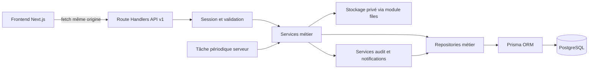
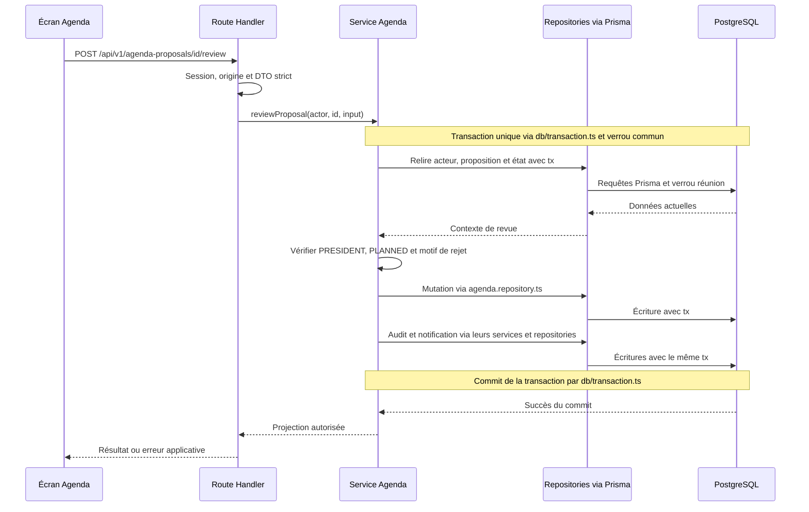
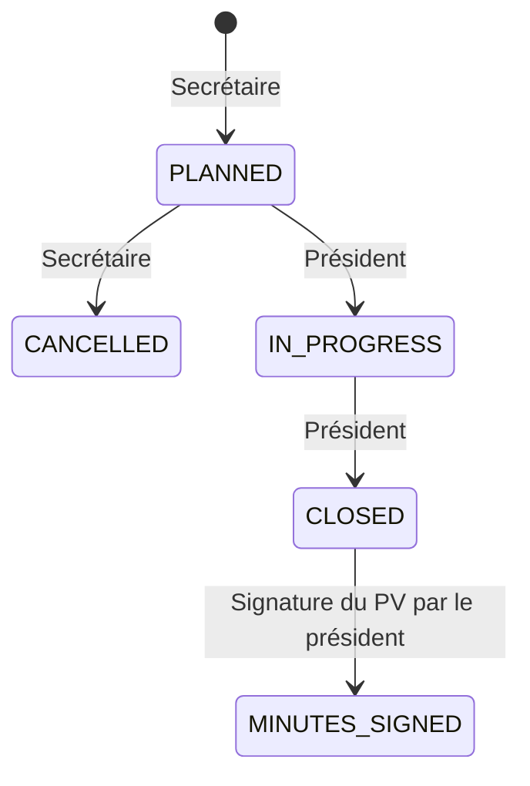
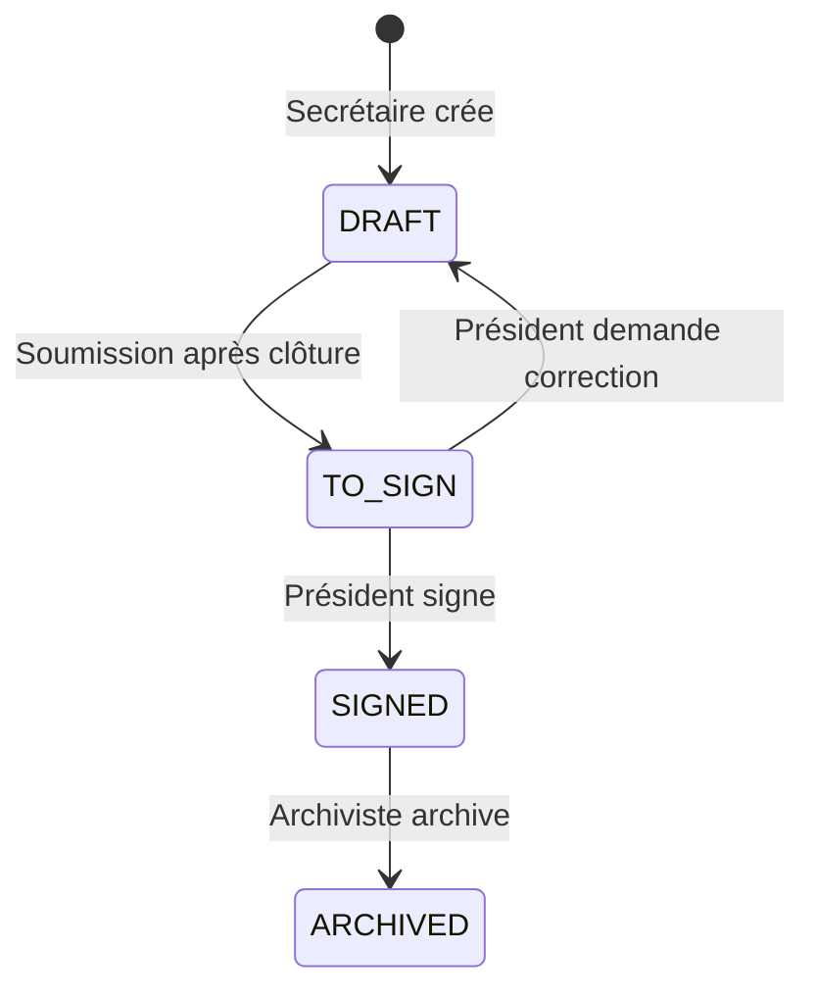

# Architecture backend V1 — Gestion du comité scientifique

**Dev Rangers · Département d'informatique · V1.1 — architecture cible avec repositories systématiques**  
**Objectif :** implémenter le backend complet de la V1 et raccorder progressivement le frontend existant.  
**Périmètre :** un comité, cinq rôles techniques, notifications exclusivement internes.

Cette version est destinée à remplacer la proposition `docs/ARCHITECTURE_BACKEND.md` après revue d’équipe. Elle conserve le monolithe modulaire, les contrats métier et les protections de persistance. La révision V1.1 adopte, conformément au choix exprimé, un DTO, un service et un repository dans chacun des 14 modules, tout en conservant les simplifications techniques de la V1. Les repositories sont concrets et propres aux domaines : aucune abstraction générique supplémentaire. Elle décrit une architecture à implémenter, pas un état du dépôt vérifié en exécution. Les décisions techniques nouvelles sont des recommandations à valider au démarrage, les règles de lecture encore indéterminées ne sont pas inventées.

## 1. Architecture retenue

| Sujet | Choix V1 |
|---|---|
| Application | Next.js App Router existant (15.2.8 selon les documents), React 19, TypeScript, UI conservée |
| Backend | Monolithe modulaire TypeScript, `backend/` à la racine, exécuté dans le processus Next.js Node |
| Transport | Route Handlers REST sous `src/app/api/v1/`, même origine que le frontend |
| Données | PostgreSQL 18.7, Prisma 7.10.1 et `@prisma/adapter-pg` existants ; 19 tables métier et six migrations conservées |
| Validation | Zod pour les commandes, filtres et DTO ; vérifier sa disponibilité dans le dépôt |
| Organisation des couches | DTO → service → repository dans chaque module ; accès aux données exclusivement via repositories (hors infrastructure DB) |
| Authentification | Session opaque révocable, stockée dans PostgreSQL ; cookie HttpOnly |
| Fichiers | Volume Docker privé persistant, métadonnées `StoredFile` existantes |
| Notifications | Écritures transactionnelles, polling léger dans l'UI, tâche périodique serveur |
| Audit | `AuditEvent` existant, ajout automatique, consultation ADMIN uniquement |
| Tests | Réutiliser node:test/tsx, tests BDD et Playwright existants |
| Déploiement | Une instance web Node, une base PostgreSQL, un ordonnanceur de rappels, volume privé |

Pas d'Express/NestJS supplémentaire, de microservices, Redis, broker, WebSocket, CQRS, ORM supplémentaire, injection de dépendances ou entités qui dupliquent Prisma. Ne pas migrer de framework ou refaire le frontend pour ce chantier. Les versions ci-dessus sont celles déclarées dans les documents fournis, pas une recommandation de mise à jour des dépendances.



### 1.1 Sources de vérité

- `ROLES_ET_PERMISSIONS.md` et `database/REGLES_INTEGRITE.md` : contrat des autorisations et des opérations ; appliquer également la dernière décision de lecture collaborative de l'agenda énoncée dans ce document.
- `database/MCD.md`, `database/MLD.md`, `database/DICTIONNAIRE_DONNEES.md`, `prisma/schema.prisma`, migrations et `database/PROTECTIONS_SQL.md` : structure et garanties réelles de persistance.
- `database/GUIDE_INTEGRATION_BACKEND.md`, `database/SEED.md`, `database/TESTS_BDD.md` : intégration, reprise et tests.
- `ARCHITECTURE.md`, `REVUE_COHERENCE_FRONTEND_BDD.md`, PDF de simulation et code frontend : comportement attendu des écrans et recette. Les rapports portant sur `4eb461b` ou `9fde791` restent historiques. L'utilisateur indique avoir finalisé le frontend, mais les dernières sources n'ont pas été fournies pour cette revue. Les corrections Markdown précédemment proposées n'ont pas été appliquées au dépôt ; leur harmonisation reste à effectuer.

Une règle métier confirmée prévaut sur un ancien rapport de maquette. Une contradiction entre règle et contrainte SQL doit être signalée, et non contournée. Le backend garantit les autorisations, même si le frontend masque déjà les boutons. Les règles non confirmées restent explicites (section 10).

## 2. Arborescence cible complète

Les fichiers ci-dessous représentent le périmètre fonctionnel final. Créer les dossiers à mesure que les modules sont implémentés ; aucun fichier vide ni interface générique anticipée. Les routes sont détaillées exhaustivement en section 6 au niveau des opérations nécessaires, sans dupliquer leur arborescence dans cette vue.

```text
.
├── backend/
│   ├── config/
│   │   └── env.ts
│   ├── db/
│   │   └── transaction.ts
│   ├── http/
│   │   ├── handler.ts
│   │   └── response.ts
│   ├── shared/
│   │   ├── errors.ts
│   │   ├── dates.ts
│   │   └── pagination.ts
│   ├── modules/
│   │   ├── auth/
│   │   │   ├── auth.dto.ts
│   │   │   ├── auth.service.ts
│   │   │   ├── auth.repository.ts
│   │   │   ├── password.ts
│   │   │   ├── session.ts
│   │   │   └── permissions.ts
│   │   ├── accounts/
│   │   │   ├── accounts.dto.ts
│   │   │   ├── accounts.service.ts
│   │   │   └── accounts.repository.ts
│   │   ├── committee/
│   │   │   ├── committee.dto.ts
│   │   │   ├── committee.service.ts
│   │   │   └── committee.repository.ts
│   │   ├── meetings/
│   │   │   ├── meetings.dto.ts
│   │   │   ├── meetings.service.ts
│   │   │   └── meetings.repository.ts
│   │   ├── agenda/
│   │   │   ├── agenda.dto.ts
│   │   │   ├── agenda.service.ts
│   │   │   └── agenda.repository.ts
│   │   ├── deliberations/
│   │   │   ├── deliberations.dto.ts
│   │   │   ├── decisions.service.ts
│   │   │   ├── ballots.service.ts
│   │   │   ├── deliberations.repository.ts
│   │   │   └── ballot-rules.ts
│   │   ├── actions/
│   │   │   ├── actions.dto.ts
│   │   │   ├── actions.service.ts
│   │   │   └── actions.repository.ts
│   │   ├── files/
│   │   │   ├── files.dto.ts
│   │   │   ├── files.service.ts
│   │   │   ├── files.repository.ts
│   │   │   └── private-storage.ts
│   │   ├── documents/
│   │   │   ├── documents.dto.ts
│   │   │   ├── documents.service.ts
│   │   │   └── documents.repository.ts
│   │   ├── minutes/
│   │   │   ├── minutes.dto.ts
│   │   │   ├── minutes.service.ts
│   │   │   ├── minutes.repository.ts
│   │   │   └── minutes-snapshot.ts
│   │   ├── archives/
│   │   │   ├── archives.dto.ts
│   │   │   ├── archives.service.ts
│   │   │   └── archives.repository.ts
│   │   ├── notifications/
│   │   │   ├── notifications.dto.ts
│   │   │   ├── notifications.service.ts
│   │   │   ├── notifications.repository.ts
│   │   │   └── reminders.service.ts
│   │   ├── audit/
│   │   │   ├── audit.dto.ts
│   │   │   ├── audit.service.ts
│   │   │   └── audit.repository.ts
│   │   └── dashboard/
│   │       ├── dashboard.dto.ts
│   │       ├── dashboard.service.ts
│   │       └── dashboard.repository.ts
│   ├── workflows/
│   │   ├── attendance.ts
│   │   ├── mandate-changes.ts
│   │   └── meeting-minutes.ts
│   ├── jobs/
│   │   └── maintenance.ts
│   └── tests/
│       ├── auth.test.ts
│       ├── committee.test.ts
│       ├── meetings-agenda.test.ts
│       ├── ballots-actions.test.ts
│       ├── documents-minutes.test.ts
│       └── notifications-audit.test.ts
├── src/
│   ├── app/
│   │   ├── [lang]/                    # Pages frontend existantes
│   │   └── api/v1/                    # Routes HTTP, cf. section 6
│   ├── lib/
│   │   ├── prisma.ts                  # Singleton serveur EXISTANT
│   │   └── api-client.ts              # Client HTTP commun, à ajouter
│   ├── features/                     # Écrans existants, adaptateurs près des modules
│   └── generated/prisma/             # Client généré, jamais édité à la main
├── prisma/
│   ├── schema.prisma
│   ├── migrations/                   # Six existantes + migration technique auth si retenue
│   └── seed.ts                       # Préserver le seed métier existant
├── tests/database/                   # Tests BDD existants
├── qa/e2e/                           # Tests navigateur existants à adapter
├── docs/
├── compose.yaml
├── prisma.config.ts
└── package.json
```

### 2.1 Responsabilités des couches

| Élément | Rôle |
|---|---|
| `config/env.ts` | Vérifie les variables réellement utilisées : URL/origine, durée de session, chemin du volume, environnement, fenêtres de rappel. Aucun secret dans le bundle client. |
| `db/transaction.ts` | Transaction commune des mutations sensibles, ordre des verrous, retries bornés et traitement des conflits. Réutilise `src/lib/prisma.ts`, aucun second singleton. |
| `http/handler.ts` | Authentification, origine des écritures, parsing limité, validation Zod, appel du cas d'usage. Handler public distinct pour connexion. |
| `http/response.ts` | Enveloppes JSON, erreurs HTTP, cache privé, identifiant de requête et logs sûrs. |
| `shared/` | Erreurs, dates civiles, pagination commune. Pas de dossier fourre-tout ni abstractions spéculatives. |
| `*.dto.ts` | Schémas d'entrée stricts, filtres et types de sortie explicites. |
| `*.service.ts` | Cas d'usage nommés, contrôle de rôle et d'objet, règles métier, orchestration, choix des projections et frontière transactionnelle. Appelle les repositories ; aucune requête Prisma directe. |
| `*.repository.ts` | Accès aux données : lectures, écritures, projections Prisma explicites, filtres de visibilité, agrégats et verrous de lignes ciblés. Reçoit le client ou la transaction existante ; ne décide pas des transitions ou droits métier et ne démarre pas de transaction autonome. |
| `workflows/` | Trois coordinations réellement transversales : présence/votes, mandat/participants, PV/réunion. |
| `jobs/maintenance.ts` | Exécute les rappels et purge technique des sessions expirées ; sortie exploitable, fermeture Prisma dans finally. |

Chaque module possède systématiquement son DTO, son service et son repository, même pour une opération simple. Les services, workflows, handlers et jobs ne réalisent pas de requêtes Prisma directes : ils passent par les fonctions des repositories, via les services propriétaires lorsque la mutation relève d'un autre module. Les exceptions d'infrastructure sont le singleton `src/lib/prisma.ts` et `db/transaction.ts` (ouverture, verrou global et reprises de transaction). Les scripts de migration, seed et tests BDD existants restent hors de cette convention applicative. Un fichier `*.access.ts` reste facultatif pour isoler une politique de lecture partagée. Aucun CRUD générique. Les fonctions pures complexes (calcul du scrutin, construction/lecture d'instantané) restent isolées. Les modules n'importent pas leurs handlers HTTP. Une commande composée ouvre une seule transaction, puis transmet `tx` aux opérations internes ; aucune transaction imbriquée. Pas d'import de code serveur depuis les Client Components. Alias `@backend/*` facultatif, à configurer dans TypeScript et les tests si retenu.

#### Convention commune des repositories

- Un repository concret par module au minimum, nommé `<module>.repository.ts`. Le module `deliberations` partage un repository entre ses services de décisions et de scrutins ; le module `notifications` le partage avec le service de rappels. `session.ts` contient les primitives de session sans requête directe ; la persistance des sessions appartient à `auth.repository.ts`.
- Les repositories importent les types Prisma nécessaires, exposent des fonctions nommées (`findMeetingForActor`, `listApprovedAgenda`, `insertAuditEvent`, etc.) et sélectionnent uniquement les champs utiles. Aucun `BaseRepository`, interface générique CRUD, conteneur d'injection ou duplication des modèles Prisma.
- Pour les lectures ordinaires, transmettre le singleton Prisma existant ; pour les écritures et lectures transactionnelles, transmettre explicitement le même `Prisma.TransactionClient` (`tx`). Utiliser des types partagés si nécessaire pour distinguer un client de lecture d'un client transactionnel ; les primitives d'écriture exigent `tx`. Aucun repli silencieux vers le singleton dans une transaction. Ne pas exposer des méthodes génériques de modification de statut à l'API.
- Le service établit l'acteur, les permissions et les préconditions ; le repository applique les prédicats d'accès fournis dans la requête avant comptage/pagination. Les projections et filtres de visibilité réutilisables restent près du domaine propriétaire. Les repositories ne lisent pas les cookies ni les DTO HTTP bruts. Les codes d'erreur métier et les notifications sont gérés par les services.
- `archives.repository.ts` et `dashboard.repository.ts` sont des repositories de lecture : ils composent les prédicats et projections autorisés des domaines, puis effectuent leurs requêtes et agrégats sur les tables existantes. Ils ne possèdent aucune table et n'effectuent aucune mutation. `files.repository.ts` gère uniquement les métadonnées SQL ; `private-storage.ts` manipule les binaires du volume.
- Le module propriétaire expose ses primitives transactionnelles ; les autres modules ne modifient pas directement ses tables. Une lecture composée peut réutiliser les prédicats ou requêtes d'un autre repository sans appeler un service orchestrateur, afin d'éviter les cycles. Les écritures d'audit et notifications passent par `record(tx, event)` et `emit(tx, event)`, qui appellent leurs repositories avec ce même `tx`.

### 2.2 Propriété des domaines et dépendances

| Module | Modèles / responsabilités | Interfaces partagées essentielles |
|---|---|---|
| auth | Account en lecture, sessions techniques | `requireActor`, `requireCapability`, `revokeSessions` |
| accounts | Account, AccountProfile | identité publique, administration et profil propriétaire |
| committee | Member, Seat, Mandate | mandats applicables, sièges actifs à une date |
| meetings | Meeting, MeetingParticipant | accès réunion, participants, transitions, invitations |
| agenda | AgendaProposal | ordre officiel, droits de proposition et de pièce |
| deliberations | Decision, Ballot, BallotVote, BallotResult | décisions, vote personnel, résultat, invalidation des votes ouverts |
| actions | CommitteeAction | Kanban, actions liées et candidates aux rappels |
| files | StoredFile | dépôt privé, métadonnées et téléchargement autorisé par parent |
| documents | Document, DocumentVersion | visibilité, validation, versions et archive |
| minutes | MeetingMinutes | brouillon, capture officielle, projection d'impression, archive |
| archives | aucune nouvelle table | agrégation des trois types d'objets archivés déjà autorisés |
| notifications | Notification | `emit(tx, event)`, destinataires actifs, cloche et boîte personnelle |
| audit | AuditEvent | `record(tx, event)`, lecture admin uniquement |
| dashboard | aucune nouvelle table | projection de statistiques accessibles, sans modifier les données |

| Repository | Responsabilité d'accès aux données |
|---|---|
| `auth.repository.ts` | Recherche du compte pour authentification (projection interne), sessions, révocation et expiration. |
| `accounts.repository.ts` | Comptes et profils, dernier admin actif, projections sans secrets. |
| `committee.repository.ts` | Annuaire, sièges, mandats, occupations à date et références historiques. |
| `meetings.repository.ts` | Réunions, participations, présence, états, scopes de réunion et candidats aux convocations/rappels. |
| `agenda.repository.ts` | Propositions, ordre officiel, auteur, revue, références et filtres d'accès. |
| `deliberations.repository.ts` | Décisions, scrutins, bulletins, résultats, captures, références de séance et projections publiques distinctes des données de calcul. |
| `actions.repository.ts` | Actions, affectations, rangs Kanban, échéances et vérification des références aux PV. |
| `files.repository.ts` | Métadonnées `StoredFile`, rattachements, recherche par clé privée et références. |
| `documents.repository.ts` | Documents, versions, visibilité, métadonnées et archivage. |
| `minutes.repository.ts` | PV, instantanés, version attendue, états et métadonnées d'archivage. |
| `archives.repository.ts` | Lecture agrégée et recherche des documents, PV et décisions archivés autorisés. |
| `notifications.repository.ts` | Boîte par destinataire, déduplication, états personnels, destinataires et compteurs. |
| `audit.repository.ts` | INSERT interne et SELECT filtré/paginé ; aucune fonction UPDATE/DELETE d'événement. |
| `dashboard.repository.ts` | Comptages et extraits filtrés, sans écriture ni table dédiée. |

Les fonctions de lecture partagées doivent appliquer le même prédicat aux listes, détails, exports, recherches et compteurs. Centraliser les politiques d’objet complexes (réunion, agenda, scrutin, document/PV) près du domaine propriétaire, dans un fichier `*.access.ts` dès qu’elles sont réutilisées. `auth/permissions.ts` porte les capacités de rôle, pas les règles de visibilité de chaque entité. Les agrégateurs et téléchargements importent ces prédicats, sans dupliquer les règles ni les contourner. Les workflows coordonnent les services propriétaires sans cycles d'import : une opération de présence utilise les primitives de réunion et de scrutin ; la signature utilise les primitives PV et réunion ; les services de base n'appellent pas en retour leur workflow orchestrateur. Audit et notification reçoivent un événement métier minimal préparé par l'appelant, ne rappellent pas les services producteurs.

### 2.3 Exemple de circulation d’une commande



Le handler ne décide jamais seul si le président a le droit de modifier la proposition ; le service revérifie le rôle et l’état de la réunion. Une erreur avant ou pendant le commit ne doit produire ni événement d’audit de succès ni notification. Les DTO, services et repositories restent dans le même dossier métier. Scinder un fichier volumineux en fonctions ou fichiers ciblés si nécessaire, sans changer la frontière du module ni supprimer sa couche repository.

## 3. Contrat métier et couverture intégrale

Cette section synthétise MET-01 à MET-30, la dernière permission de consultation de l'agenda, et les règles de représentation et d'archivage. Elle doit être lue avec le référentiel de permissions et les contraintes SQL, non comme un remplacement de ces documents.

| Références | Module responsable |
|---|---|
| MET-01, 02 | auth/accounts : comptes, profil, dernier admin, révocation |
| MET-03, 04 | committee + workflow mandat : intégrité et historique |
| MET-05, 06, 07 | meetings : planification, convocations, annulation, séance |
| MET-08, 09 | agenda : revue, retrait, ordre et lecture collaborative |
| MET-10 | workflow attendance : présence et invalidation |
| MET-11 à 17 | deliberations : décision, scrutin, vote, résultat et historique |
| MET-18, 19 | actions : gestion, droits personnels et Kanban |
| MET-20 à 22 | documents/files : versions, visibilité, validation et accès |
| MET-23 à 25 | minutes + workflow + modules propriétaires : PV et archives |
| MET-26 à 29 | notifications : ciblage, états, déduplication et rappels |
| MET-30 | audit : émission et lecture seule |
| Lecture agrégée et parité frontend | dashboard/archives + politiques de lecture des domaines |

### 3.1 Comptes, membres et mandats

L'administrateur technique administre comptes, annuaire, mandats et sièges dans le périmètre validé. Le login et le courriel de l'annuaire sont normalisés et uniques chacun dans leur table ; le courriel de contact du profil ne modifie pas le login. Le rôle d'accès du compte est indépendant de la fonction du mandat. Un compte non-admin possède un membre lié unique. Le compte inactif ne peut plus se connecter ni agir ; la désactivation conserve l'historique. Aucun rôle ne peut retirer le dernier admin actif. Profil et réinitialisation des surcharges réservés au propriétaire.

Création du membre et du premier mandat atomique. Les bornes sont inclusives, pas de chevauchement par siège/qualité, membre ou fonction spéciale selon les exclusions SQL. Un renouvellement ajoute un mandat, ne réécrit pas l'ancien. Un mandat référencé par séance démarrée/historique est protégé, pas de suppression de membre référencé. Correction de mandat/date : revalider les participations planifiées ; refuser toute invalidation historique ou perte de validité non résolue. Le quorum inclut aussi les sièges actifs de membres non invités ; ne pas modifier rétrospectivement le périmètre de représentation d'une séance en cours. Les permissions fines de retrait et d'annuaire restent traitées en section 10.

### 3.2 Réunions et agenda



- Secrétaire seul : planifier, modifier une réunion planifiée, gérer les participants et convoquer/renvoyer. Valider titre, date, salle, début/fin (même journée) et mandat applicable de chaque participant. Pas de convocation si aucun compte actif destinataire. Modification significative après convocation : notifier anciens et nouveaux participants actifs ; pas d'avis pour un simple réordre d'agenda.
- Annulation : secrétaire seul, `PLANNED` → `CANCELLED`, sans nouveau champ ; conserver données et historique. Notifier uniquement les comptes actifs réellement déjà convoqués, dédupliqués à partir des convocations persistées (y compris retirées de la boîte). Aucun avis si jamais convoquée. Aucun démarrage, édition, convocation, rappel ou mutation de séance/agenda après annulation ; lecture historique autorisée selon périmètre.
- Président seul : démarrer si informations complètes, au moins un participant et un point approuvé ; clôturer si aucun scrutin ouvert. L'agenda, les données initiales et la composition sont verrouillés après sortie de `PLANNED`. Pas de réouverture. Président/secrétaire gèrent la présence en cours ; elle est ternaire (null, true, false) et verrouillée à la clôture. Les instants effectifs sont serveur.
- Agenda : président, secrétaire et membres titulaires/suppléants proposent en leur propre nom, dans une réunion accessible et planifiée. L'auteur édite et retire uniquement sa proposition `PROPOSED` ou `REJECTED` ; retrait interdit si référence métier, indépendamment des références historiques audit/notification. Président seul valide/rejette, y compris les propositions du secrétaire ; motif de rejet non blanc obligatoire. Président seul réordonne les `APPROVED` tant que planifiée. Les `APPROVED` seuls composent l'ordre officiel. Les chemins Réunions et Agenda utilisent les mêmes commandes.
- **Dernière règle validée :** président, secrétaire, titulaires et suppléants consultent les propositions des autres membres dans les réunions auxquelles ils ont accès, y compris les non validées et rejetées. La lecture n'accorde aucun droit de modification, retrait, revue ou ordre. Elle n'élargit pas l'accès aux réunions hors invitation. Les droits fins des pièces et des autres rôles ne sont pas étendus arbitrairement ; appliquer le périmètre confirmé et le contrôle du parent. Pas d'API de désignation arbitraire de représentant.

### 3.3 Scrutins, décisions, représentation

Le président seul crée une décision `PENDING` pendant `IN_PROGRESS`, avec référence unique, réunion obligatoire, point facultatif de la même réunion (condition d'approbation à confirmer si elle est requise par le référentiel). Il ouvre et clôture le scrutin et paramètre les seuils dans les limites existantes. Un scrutin au maximum par décision, aucun second tour, même sans quorum. Les états et la provenance finale ne sont jamais fixés librement par le client.

La représentation est dérivée des mandats à la date de réunion et de la feuille de présence, et non d'un choix arbitraire de siège. Siège actif = au moins un mandat valide, invité ou non. Titulaire actif présent prioritaire, sinon suppléant actif présent (y compris titulaire vacant selon le choix V1 du MET-13). Présence inconnue = inéligible. Le bug de clic sur le représentant dans la maquette ne doit pas introduire un attribut de représentant persistant. Si le clic concerne la feuille de présence réelle d’une séance, le serveur enregistre la présence autorisée puis recalcule la représentation ; si le clic concerne la vue de simulation de l’annuaire, conserver une simulation d’interface séparée sans mutation de séance ni stockage métier du représentant. Son correctif réel et le chemin exact concerné n’ont pas été vérifiés sur les sources actuelles.

Président, secrétaire et membre actifs, liés à un membre éligible, votent pour leur propre siège pendant une séance en cours et un scrutin ouvert. Le serveur déduit les identifiants de réunion, participation, mandat et siège ; une FK composite et deux unicités protègent la provenance et le vote unique. La modification ou le retrait concernent uniquement son propre vote. Tout changement de présence ou d'éligibilité invalide les votes ouverts devenus incompatibles, sans restaurer d'anciens choix. Un scrutin clos est immuable.

| Calcul | Formule / résultat |
|---|---|
| Quorum | `ceil(activeSeats * quorumPercent / 100)` ; atteint si actifs > 0 et représentés >= minimum. Basé sur la représentation, pas sur le nombre de bulletins. |
| Exprimés | pour + contre ; abstention exclue de la majorité, incluse dans les votes déposés |
| Non déposés | sièges représentés - votes déposés |
| Majorité | exprimés > 0 et `pour * 100 > majorityPercent * exprimés` ; arithmétique exacte (Decimal ou entiers mis à l'échelle) |
| Sans quorum | résultat `QUORUM_NOT_REACHED`, décision `PENDING`, provenance null, blocage dérivé ; pas de nouvel essai, action liée ou archivage définitif |
| Avec quorum | décision `ADOPTED` ou `REJECTED`, `finalSource=BALLOT` ; avis automatique, une occurrence par résultat/destinataire |

Clôture atomique : recalculer après acquisition des verrous, insérer `BallotResult` avec les captures versionnées de présence et représentation pendant `OPEN`, passer à `CLOSED`, appliquer l'issue à la décision et écrire audit/notifications, commit. Le résultat stocké fait foi pour les lectures historiques ; ne pas recalculer avec les données courantes. Les valeurs historiques `HISTORICAL_IMPORT` sont réservées à la reprise contrôlée.

**Confidentialité :** exposer le vote propre de l'acteur et les résultats agrégés autorisés. Aucun rôle (y compris ADMIN) ne reçoit les choix nominatifs d'autrui, même en export, impression, journal d'audit ou réponse de clôture. Les identités de représentants peuvent être affichées selon les droits, sans association à leur choix individuel. Le calcul interne dispose des bulletins.

### 3.4 Actions et Kanban

Président et secrétaire ont exactement les mêmes droits : créer, éditer titre/description/priorité/échéance/décision liée, attribuer/réattribuer, changer tout statut et ordre, déplacer et supprimer selon conservation. Le membre affecté peut uniquement changer le statut de sa propre action ; aucun autre champ ni ordre choisi librement. Le serveur calcule les rangs et protège les cartes concurrentes. Responsable membre obligatoire, décision liée facultative mais adoptée, date de la décision <= échéance. Le retard est dérivé de la fin de journée civile à Alger, hors `DONE`.

Une action présente dans une capture de PV signé ou archivé ne peut jamais être supprimée, même après changement de son rattachement. Le suivi de cette action reste possible sans réécrire le PV. La vérification porte sur les identifiants historiques, pas seulement sur les relations actuelles. Le cas d’une action supprimée après soumission mais avant signature reste à confirmer : proposition de garde à valider, refuser la signature de la version concernée et demander une nouvelle soumission. La protection déjà confirmée ne concerne que les PV signés ou archivés ; ne pas présenter cette garde additionnelle comme une règle métier validée. Ne pas fabriquer les identifiants manquants des captures historiques ; signaler les cas non résolubles. Les autres règles de conservation restent celles du référentiel.

### 3.5 Documents, fichiers et PV

**Bibliothèque.** Secrétaire seul crée, édite les documents non archivés, dépose une nouvelle version, valide `DRAFT` → `APPROVED`, choisit/modifie la visibilité `COMMITTEE`, `PRESIDENCY`, `ARCHIVES`. Pas de circuit supplémentaire. Aucun rôle ne supprime un document de bibliothèque par une opération ordinaire. Un document archivé est immuable. La validation/édition n'accorde pas de nouveau droit de lecture (notamment après choix `ARCHIVES`). Création sans version possible ; chaque nouvelle version possède fichier réel, auteur authentifié et numéro unique. Le document peut être rattaché à une réunion ; aucune relation directe document–point. Les pièces de proposition appartiennent à la proposition ; le fichier documentaire à sa version. Le type `DocumentType.MINUTES` n'est pas le PV métier `MeetingMinutes`.

**Fichiers.** Limite 10 Mio par fichier, cinq pièces par proposition ; contrôle de taille effective, format et MIME, nom sûr, stockage privé avec clé générée, jamais un chemin public. Formats d'agenda documentés : PDF, DOC, DOCX, PNG, JPG, TXT ; valider les formats avec contrôle de contenu, rejeter ceux non pris en charge de façon sûre (ne pas changer silencieusement le périmètre). Les versions importées sans binaire sont signalées indisponibles, pas de faux fichiers. Lecture via le parent autorisé ; aucun accès par URL publique ou chemin fourni par l'utilisateur.



**PV.** Un PV par réunion. Secrétaire crée en cours ou clôturée, édite le brouillon uniquement. Soumission après clôture, résumé non blanc et au moins un présent : capture officielle versionnée de la séance, participants, agenda officiel, décisions/résultats autorisés, actions liées, notes et identités. Retour pour correction vers `DRAFT`, non vers un statut autonome ; motif selon règle validée, `returnedAt`. Nouvelle soumission remplace la capture non signée. Président signe la version soumise attendue, sans reconstruire son contenu ; signature, réunion `MINUTES_SIGNED`, audit et notifications dans une seule transaction. Les versions soumises, signées et archivées sont rendues depuis leur capture ; le brouillon utilise les données courantes. Impression/export navigateur à partir de la projection autorisée, pas de service PDF supplémentaire. Signature métier authentifiée, non cryptographique. Les modifications ultérieures ne réécrivent pas l'historique.

### 3.6 Archives et tableau de bord

Archiviste seul archive les PV signés, décisions définitives de réunions clôturées ou avec PV signé, documents éligibles conformément à MET-25 (pas d'archivage qui interfère avec une séance en cours ; cas précis des documents de réunion planifiée à confirmer). Renseigner acteur/date ; pas de désarchivage ou mutation ordinaire des objets métier archivés. Les permissions de lecture d'origine demeurent. Les archives agrègent trois sources sans nouvelle table, avec type stable, date, réunion, titre/référence et recherche normalisée casse/accents/ponctuation. Le filtre « Procès-verbal » inclut les entrées PV métier. Rechercher le contenu officiel figé, jamais la version vivante d'un PV signé. Filtrer l'accès avant recherche, extraits, agrégation et pagination. Pour la faible volumétrie d'un comité, une recherche normalisée en TypeScript sur les seules projections autorisées et bornées est acceptable ; ne pas paginer avant filtrage textuel, ni tronquer silencieusement les résultats. Pas de plein texte indexé ni recherche binaire en V1.

Le dashboard renvoie une projection unique, avec compteurs indépendants des extraits : total de prochaines réunions autorisées et trois prochaines, membres avec mandat actif selon périmètre, actions par statut et échéances, décisions par résultat, notifications récentes et compteur non lu. Pour le rôle MEMBER, les actions sont personnelles. Tous les compteurs utilisent les droits des listes correspondantes, même pour l'admin ; aucun accès global implicite. Ne pas utiliser la longueur de l'extrait de trois réunions pour le total.

### 3.7 Notifications internes et audit

| Événement | Destinataire actif |
|---|---|
| Convocation, renvoi, modification significative | participants concernés ; union anciens/nouveaux pour modification |
| Annulation | comptes effectivement convoqués, dédupliqués |
| Proposition / resoumission, validation / rejet | président(s) / auteur respectivement |
| Décision adoptée ou rejetée | participants, une occurrence par résultat |
| Attribution, réattribution, échéance | responsable ; ancien et nouveau en cas de réattribution |
| PV soumis, retourné, signé | président(s) ; secrétaire(s) ; secrétaire(s) et avis distinct aux archivistes |
| Rappel réunion | participants actifs, réunion planifiée à venir dans les 24 h |
| Rappel action / retard | responsable actif, non terminée à 48 h de la fin de l'échéance puis à partir du retard |

Utiliser les types existants, pas de nouveaux enums pour ces événements. Pour un ciblage de rôle, tous les comptes actifs concernés selon le choix V1 documenté. Aucune notification externe, aucun e-mail/SMS. Mutations et effets atomiques ; si aucun destinataire actif, l'opération ordinaire réussit sans avis sauf convocation explicite. Clé stable par occurrence/destinataire, différente pour un renvoi volontaire. Un lien n'étend jamais l'accès ; le texte d'un avis destiné à un ancien participant/responsable reste minimal. Les notifications ne sont pas une source de vérité métier, sauf preuve des destinataires effectivement convoqués conservée par les lignes existantes.

Boîte personnelle : lecture/non lu (`readAt`), archive/restauration (`archivedAt`), retrait terminal (`deletedAt`). Seul destinataire agit ; toutes les lectures/compteurs excluent les retirées. Pas de réactivation ni purge physique des lignes dédupliquées. Centre, cloche et tableau de bord partagent la même source.

**Audit :** `record(tx, event)` enregistre actorAccountId, code d'opération, instant serveur, type d'objet, UUID et détails minimaux JSON. Historique conservé même après suppression légitime de la cible. Tracer comptes/rôles, mandats, réunions/convocations/annulation, agenda, décisions/scrutins, actions, documents/versions, PV/archives et imports. Aucun mot de passe, hash, jeton, cookie, corps de requête ou choix de vote nominatif. Pas de création manuelle par API ; `GET /audit-events` pour ADMIN uniquement, filtres date/acteur/type/opération et pagination. Même l'admin ne peut modifier/supprimer les événements. Ne pas exposer les détails privés d'un objet métier via l'audit.

## 4. Authentification et permissions

### 4.1 Session réelle

Conserver la session opaque proposée : 32 octets aléatoires cryptographiques, cookie contenant le jeton et seul SHA-256 du jeton en base. Cookie HttpOnly, SameSite=Lax, Path=/, Secure en HTTPS (préfixe `__Host-` en production sans Domain). `requireActor` charge session valide et compte actif depuis PostgreSQL à chaque requête ; aucun rôle/ID d'acteur envoyé par le navigateur n'est une preuve. Déconnexion révoque la session (suppression ou date de révocation) et efface le cookie. Révoquer toutes les sessions du compte après changement de mot de passe/rôle/membre ou désactivation. Vérifier à nouveau l'acteur et la session dans les transactions d'écriture.

**Seule évolution structurelle proposée pour cette architecture :** ajouter une table technique `account_sessions` / `AccountSession` dans une nouvelle migration, sans modifier les six migrations existantes. Champs minimaux : id UUID, accountId FK, tokenHash unique, createdAt, expiresAt ; index compte et expiration. Révocation par suppression de session (pas de rétention métier de ces lignes). Durée absolue proposée de 12 h, sans rafraîchissement glissant en V1 : plus simple, à valider par l'équipe. La déconnexion expire immédiatement côté serveur. Purger les sessions expirées par tâche périodique. Adapter explicitement les tests de catalogue (19 tables métier + une technique et sept migrations si ce choix est retenu). Ne pas créer une table de rôles/permissions. Aucun besoin de changement structurel pour les nouvelles permissions métier.

Compatibilité seed : format `scrypt$ln=17,r=8,p=1$<sel-base64url>$<empreinte-base64url>` ; sel 16 octets, empreinte 64 octets, N=131072, r=8, p=1, maxmem=256 Mio selon le guide. Valider format/longueurs, dériver en asynchrone et comparer en temps constant. Hachage hors transaction longue, relire hash/état sous verrou avant création de session pour empêcher une connexion concurrente à une désactivation. Ne jamais transmettre hash ou mot de passe dans un DTO. Échec de connexion générique, limiter tentatives par compte normalisé et IP issue d'une chaîne proxy de confiance. Pour la V1 mono-instance, limite mémoire bornée avec expiration + limite d'entrée/proxy : choix technique minimal, non durable après redémarrage ; si exigences multi-instance ou durabilité, prévoir un mécanisme partagé (potentielle évolution technique distincte). Limiter aussi la concurrence des dérivations scrypt. La politique réelle des mots de passe et les seuils de débit sont à valider ; ne pas confondre la limite de démo avec une politique de production. Pas d'inscription publique ni de récupération par e-mail ; compte provisionné par ADMIN, remise de secret temporaire hors application selon procédure d'équipe.

Protection des écritures : origine exacte configurée sur POST/PUT/PATCH/DELETE (connexion et multipart inclus), Content-Type attendu, limites de corps, HTTPS en production. Le middleware ne sert qu'à localisation/redirection ; les handlers/services protègent réellement les ressources. Pages privées et `GET /me` ne se fient jamais au cookie de démonstration.

### 4.2 Matrice des opérations confirmées

C = autorisé si conditions métier remplies ; — = pas de droit sur cette opération. Membre titulaire/suppléant = même rôle MEMBER, éligibilité au vote différente. Les droits de lecture encore ouverts ne sont pas tranchés par cette matrice.

| Opération | ADMIN | PRESIDENT | SECRETARY | MEMBER | ARCHIVIST |
|---|:---:|:---:|:---:|:---:|:---:|
| Administrer comptes, annuaire, mandats | C | — | — | — | — |
| Planifier, modifier, convoquer, annuler réunion planifiée | — | — | C | — | — |
| Démarrer/clôturer réunion | — | C | — | — | — |
| Renseigner présences en cours | — | C | C | — | — |
| Consulter propositions d'autrui dans réunions accessibles | à confirmer | C | C | C | à confirmer |
| Proposer, éditer/retirer sa propre proposition admissible | — | C | C | C | — |
| Approuver/rejeter/réordonner agenda officiel | — | C | — | — | — |
| Créer décision / ouvrir, paramétrer, clôturer scrutin | — | C | — | — | — |
| Voter/modifier/retirer son propre vote | — | C | C | C | — |
| Consulter choix nominatifs des autres votants | — | — | — | — | — |
| Gestion complète des actions | — | C | C | — | — |
| Changer statut de son action | — | C | C | C | — |
| Créer/éditer document, déposer version, valider, choisir visibilité | — | — | C | — | — |
| Supprimer document de bibliothèque | — | — | — | — | — |
| Rédiger/soumettre PV | — | — | C | — | — |
| Retourner pour correction / signer PV | — | C | — | — | — |
| Archiver PV, décision, document éligible | — | — | — | — | C |
| Profil personnel et notifications personnelles | C | C | C | C | C |
| Consulter journal d'audit | C | — | — | — | — |
| Modifier/supprimer événement audit | — | — | — | — | — |

### 4.3 Matrice de lecture documentaire

| Visibilité / état | ADMIN | PRESIDENT | SECRETARY | MEMBER | ARCHIVIST |
|---|:---:|:---:|:---:|:---:|:---:|
| Document COMMITTEE | Oui | Oui | Oui | Oui | Oui |
| Document PRESIDENCY | Oui | Oui | Oui | Non | Oui |
| Document ARCHIVES | Oui | Oui | Non | Non | Oui |
| PV DRAFT / TO_SIGN | Non | Oui | Oui | Non | Non |
| PV SIGNED / ARCHIVED | Oui | Oui | Oui | Oui | Oui |

Sous réserve du compte actif et du périmètre d'objet autorisé. `ARCHIVES` est une visibilité, `ARCHIVED` un état, indépendants. Pas de permission de lecture implicite dérivée d'un rôle d'écriture. Les listes de comptes sont administratives ; les surcharges privées de profil restent personnelles. Les réunions conservent leurs invitations et accès métier existants. Les actions d'un membre sont filtrées par son affectation. Les décisions, scrutins, pièces et archives appliquent leurs scopes confirmés ; ne pas ouvrir un périmètre en attente de validation. Le téléchargement réutilise la politique du document ou de la proposition parent. Le frontend peut utiliser capacités et indicateurs `can*` renvoyés par le serveur, sans que ceux-ci remplacent un contrôle métier serveur.

## 5. Transactions et stockage : simplification V1

**Choix d'implémentation proposé :** au lieu de multiplier les verrous par domaine et les stratégies d'isolation, employer un verrou transactionnel consultatif PostgreSQL commun aux mutations du comité (mono-comité, faible volumétrie). Dans `transaction.ts`, ouvrir une transaction courte `READ COMMITTED`, acquérir le même `pg_advisory_xact_lock` à clé constante documentée, relire les données décisives et valider l'acteur, puis effectuer toutes les écritures. Les lectures ordinaires ne prennent pas ce verrou. Les commandes de connexion/révocation, mutations de comptes, opérations métier, rappels et nettoyages qui peuvent interférer suivent la même convention ; aucune voie d'écriture ordinaire ne la contourne. Conserver l'ordre de verrouillage des protections SQL : calendrier/mandats si nécessaire → réunions par UUID → scrutins par UUID → dépendances ; le verrou global est toujours premier. Aucun appel réseau, hachage ou upload long sous ce verrou. Les opérations SQL directes hors backend ne bénéficient pas de ce verrou et restent réservées à l'exploitation contrôlée. Le verrou est partagé entre processus via PostgreSQL, pas via une variable JS.

Cette stratégie sérialise volontairement les écritures de la V1, simplifie les courses du dernier admin, du quorum, du Kanban, du PV et des versions, au prix d'un débit d'écriture plus faible. Pour un seul comité ce compromis est raisonnable ; tester sous concurrence, mesurer avant de complexifier. Elle n'est pas une protection contre un accès SQL privilégié. Les triggers/FK/CHECK/exclusions restent obligatoires. Les lectures dont plusieurs projections doivent être cohérentes (PV, dashboard, résultat) utilisent une vue transactionnelle appropriée ; pas de verrou global pour une lecture ordinaire.

| Opération sensible | Frontière atomique |
|---|---|
| Comptes et sessions | Dernier admin, révocation, audit ; relecture du compte/hash pour la création de session |
| Mandat | Correction + revalidation des participations, invalidation des votes ouverts admissible, audit |
| Réunion/agenda | Verrou réunion, autorisation, transition/revue/retrait/ordre, notifications/audit |
| Présence | Réunion puis scrutins concernés ; feuille et invalidation des votes ouverts |
| Vote/clôture | Réunion puis scrutin ; vote propre ou résultat avant passage CLOSED, décision et effets au même commit |
| Action/Kanban | Responsable, décision, rangs, historique de PV, audit et notifications |
| Version documentaire | Parent, numéro unique, fichier référencé, audit |
| PV | Réunion puis PV, version attendue, capture, signature/statut et effets ; vérifier la course suppression d'action |
| Archive | Parent puis objet, éligibilité, métadonnées initiales uniquement, audit |
| Convocation/rappel | Revalidation du contexte, destinataires et clés de déduplication, écriture atomique |

Passer `tx` à chaque repository intervenant dans la commande, ainsi qu’aux fonctions `record` et `emit`. La transaction est ouverte par le service ou workflow orchestrateur via `db/transaction.ts`, jamais par un repository ; toutes les requêtes de la commande emploient ce même client transactionnel. Intercepter aussi les erreurs au commit (contraintes différées). Réessayer seulement les conflits transitoires reconnus `P2034`, `40001`, `40P01`, trois tentatives bornées avec délai ; relecture complète et identifiant d'occurrence stable. Les contraintes métier connues donnent une erreur, pas un retry automatique. Les envois volontaires de convocations utilisent une clé d'idempotence stable par commande, conservée dans l'audit et/ou les clés de notification sous le verrou ; un nouveau renvoi volontaire utilise une autre clé. Les transitions terminales répétées ne produisent pas d'effet supplémentaire. L'UI relit l'état après une réponse perdue. Les migrations/seed ne tournent pas pendant les mutations de l'application.

### 5.1 Stockage privé simple et fiable

Le volume n'est pas sous `public/`. Valider droits, taille et contenu avant de promouvoir le fichier. Écrire temporairement hors transaction et générer une clé aléatoire et éventuellement le checksum SHA-256 prévu. Sous transaction courte et verrou métier, revalider parent, quota et droit, promouvoir le fichier validé sur le même volume par renommage, puis enregistrer les métadonnées et la version/liaison. Garder les effets de fichier idempotents lors de retries (clé et fichier final stables, vérifier avant promotion). Après rollback certain, supprimer uniquement le fichier non référencé ; si commit ambigu, vérifier par nouvelle lecture et différer l'effacement si doute. Le téléchargement exige métadonnée et autorisation du parent, utilise la clé privée validée, `Content-Disposition: attachment`, `nosniff`, flux borné. Distinguer version historique indisponible d'une erreur de stockage. Pour retrait d'une proposition ou pièce autorisée, traiter les références SQL avant la suppression physique et conserver les références d'audit.

Pour éviter un mécanisme concurrent complexe de réconciliation, prévoir une procédure de nettoyage d'orphelins en maintenance hors uploads (arrêt web / mode maintenance), après comparaison des clés avec `StoredFile`, période de grâce et sauvegarde. Ne jamais nettoyer un fichier référencé. Une automatisation plus fine est reportable. Sauvegarder/restaurer le volume avec la base. Le déploiement mono-instance est une hypothèse V1 ; le stockage multi-instance partagé n'est pas nécessaire à cette livraison.

## 6. API REST — surface complète V1

Les chemins ci-dessous sont relatifs à `/api/v1`. Chaque ressource ou commande correspond à un `route.ts` dans l'App Router, hors segment `[lang]`. Les routes exposent les services, jamais les repositories ni une table Prisma en CRUD libre. Les handlers s'exécutent en runtime Node, et les réponses authentifiées sont `Cache-Control: private, no-store`. Aucun handler ne contient le calcul d'un vote ou une transition métier. Regrouper GET/POST ou GET/PATCH/DELETE dans un même fichier lorsqu'ils partagent le chemin.

| Domaine | Lectures GET | Mutations |
|---|---|---|
| Auth | `/me` | `POST /auth/sign-in`, `POST /auth/sign-out` |
| Profil | `/me/profile` | `PATCH /me/profile`, `DELETE /me/profile` (réinitialisation des surcharges), `POST /me/change-password` si prévu dans le parcours réel |
| Comptes | `/accounts`, `/accounts/{id}` | `POST /accounts`, `PATCH /accounts/{id}` (champs administratifs explicitement autorisés, dont rôle/activation/liaison ; révocation contrôlée), `POST /accounts/{id}/reset-password` (admin) |
| Comité | `/members`, `/members/{id}`, `/members/{id}/mandates`, `/seats` avec `asOf` pour occupation | `POST /members` avec premier mandat, `PATCH /members/{id}`, `POST /members/{id}/mandates`, `PATCH /mandates/{id}` ; `POST /seats`, `PATCH /seats/{id}` et retrait membre non référencé uniquement selon droits confirmés |
| Réunions | `/meetings` (date/statut/recherche), `/meetings/{id}` (participants/présences et résumé d'agenda autorisés) | `POST /meetings`, `PATCH /meetings/{id}`, `PUT /meetings/{id}/participants`, `PATCH /meetings/{id}/attendance`, `POST /meetings/{id}/invitations`, `POST /meetings/{id}/cancel`, `POST /meetings/{id}/start`, `POST /meetings/{id}/close` |
| Agenda | `/meetings/{id}/agenda` (officiel), `/agenda-proposals?meetingId=…`, `/agenda-proposals/{id}` | `POST /meetings/{id}/agenda-proposals`, `PATCH /agenda-proposals/{id}`, `POST /agenda-proposals/{id}/review`, `PUT /meetings/{id}/agenda/order`, `DELETE /agenda-proposals/{id}` ; `POST /agenda-proposals/{id}/attachments`, `DELETE /agenda-proposals/{id}/attachments/{fileId}` si retrait permis ; resoumission/remise en attente seulement selon contrat confirmé |
| Décisions | `/decisions`, `/decisions/{id}` | `POST /meetings/{id}/decisions`, `POST /decisions/{id}/archive` |
| Scrutins | `/ballots`, `/ballots/{id}` (représentation, vote propre, agrégats autorisés, résultat final si disponible) | `POST /decisions/{id}/ballot`, `PATCH /ballots/{id}/thresholds`, `PUT /ballots/{id}/my-vote`, `DELETE /ballots/{id}/my-vote`, `POST /ballots/{id}/close` |
| Actions | `/actions`, `/actions/{id}` | `POST /actions`, `PATCH /actions/{id}` (champs de gestion), `PATCH /actions/{id}/status` (statut seul), `POST /actions/{id}/move` (ordre/statut de carte), `DELETE /actions/{id}` |
| Documents | `/documents`, `/documents/{id}` (versions autorisées incluses) | `POST /documents` (JSON sans fichier ou multipart avec première version), `PATCH /documents/{id}`, `POST /documents/{id}/versions`, `POST /documents/{id}/approve`, `POST /documents/{id}/archive` |
| Fichiers | `/files/{id}/content` | Dépôts portés par les parents agenda/version, aucun CRUD autonome public |
| PV | `/minutes`, `/minutes/{id}` (aperçu ou capture officielle et informations imprimables) | `POST /meetings/{id}/minutes`, `PATCH /minutes/{id}`, `POST /minutes/{id}/submit`, `POST /minutes/{id}/return`, `POST /minutes/{id}/sign`, `POST /minutes/{id}/archive` |
| Archives | `/archives` (type/réunion/date/recherche) | Archivages portés par les objets propriétaires ; pas de désarchivage |
| Notifications | `/notifications`, `/notifications/{id}`, `/notifications/summary` | `PATCH /notifications/{id}` (lu/non lu, archive/restauration), `POST /notifications/mark-all-read`, `DELETE /notifications/{id}` (retrait logique) |
| Audit | `/audit-events` (admin, filtres et pagination) | Aucune écriture publique |
| Dashboard | `/dashboard/overview` | Aucune |

Le calendrier utilise la liste de réunions filtrée sur une période ; la cloche utilise la synthèse des notifications ; l'impression utilise le DTO du PV, sans endpoint PDF distinct ; le détail de scrutin contient le résultat persistant, sans deuxième endpoint obligatoire. Les changements de rôle/activation d'un compte peuvent partager `PATCH /accounts/{id}` mais doivent appeler une commande métier contrôlée, pas un update libre. Les opérations optionnelles du tableau doivent être validées avant exposition ; ne pas créer de permission nouvelle en déduisant un droit de l'existence d'une route.

Exemple de structure de routes (les autres suivent la même convention) :

```text
src/app/api/v1/
├── auth/
│   ├── sign-in/route.ts
│   └── sign-out/route.ts
├── me/
│   ├── route.ts
│   └── profile/route.ts
├── meetings/
│   ├── route.ts
│   └── [id]/
│       ├── route.ts
│       ├── attendance/route.ts
│       ├── cancel/route.ts
│       ├── invitations/route.ts
│       ├── start/route.ts
│       ├── close/route.ts
│       ├── participants/route.ts
│       ├── agenda/route.ts
│       ├── agenda/order/route.ts
│       ├── agenda-proposals/route.ts
│       ├── decisions/route.ts
│       └── minutes/route.ts
├── ballots/
│   ├── route.ts
│   └── [id]/
│       ├── route.ts
│       ├── thresholds/route.ts
│       ├── my-vote/route.ts
│       └── close/route.ts
└── audit-events/route.ts
```

### 6.1 Contrats et formats

- Valider paramètres, filtres et corps avec Zod strict ; listes d'UUID sans doublon, champs et longueurs autorisés, dates réelles, nombres finis, seuils 1–100 avec deux décimales maximum, limites multipart. Ne jamais propager `body` directement vers `prisma.*.update({data: ...})`.
- Utiliser UUID en chaîne, enums Prisma en codes stables, dates civiles `YYYY-MM-DD`, heures `HH:mm`, instants ISO 8601 UTC, présence nullable, champs optionnels à `null`. Interpréter les journées/échéances dans `Africa/Algiers`, indépendamment du navigateur. Seuils décimaux en chaînes canoniques sur le contrat HTTP, convertis explicitement. Traduction dans l'UI, pas dans les codes de stockage.
- Exemples : `PUT /ballots/{id}/my-vote` reçoit `{"choice":"FOR"}` et rien sur la provenance ; `PATCH /meetings/{id}/attendance` reçoit `{"entries":[{"participantId":"uuid","attendance":true}]}` ; `POST /minutes/{id}/sign` reçoit `{"expectedVersion":3}` ; review reçoit décision de revue et note, jamais auteur de revue. `POST /actions/{id}/move` reçoit statut et position admissibles (le serveur recalcule). `PATCH /actions/{id}/status` n'accepte que le statut. Les acteurs, états dérivés, instants, résultats et archives sont calculés par le serveur.
- Projections explicites : jamais d'objet Account complet ni de `passwordHash`, jeton, clé privée de stockage ou vote d'autrui. Les résultats et captures historiques lisibles sans inventer les acteurs, dates ou binaires absents. Les DTO ne dupliquent pas toute la base : sélectionner ce que les écrans utilisent.
- Pagination simple `page` (>=1) et `pageSize` (25 par défaut, 100 max), ordre stable avec UUID en dernier critère. Retour `{ "data": [], "page": { "number": 1, "size": 25, "total": 0 } }`. Pour les listes bornées (participants, sièges, colonnes du Kanban), fournir les données nécessaires sans paginer artificiellement une projection indivisible ; définir une borne ou un filtre adapté. Les totaux sont calculés après droits et filtres, dans la même vue de lecture si cohérence requise. Curseurs complexes reportés. Archive et audit : filtrer puis trier par instant décroissant et ID stable ; indiquer que la pagination par page peut évoluer sous nouvelles insertions.
- Réponse ressource/mutation `{ "data": ... }`, 201 création, 200 lecture/commande avec représentation, 204 sans contenu. Le téléchargement renvoie un flux, pas JSON. Un seul format d'erreur, même en authentification et validation.

```json
{
  "error": {
    "code": "BALLOT_ALREADY_CLOSED",
    "message": "Ce scrutin est clôturé.",
    "requestId": "uuid"
  }
}
```

| Code HTTP | Cas |
|---|---|
| 400 | Entrée/filtre invalide, JSON mal formé |
| 401 | Session absente, expirée, invalide ; identifiants incorrects |
| 403 | Action interdite sur objet visible, origine interdite |
| 404 | Objet absent ou hors périmètre de lecture (même réponse) |
| 409 | État/version incompatible, unicité, référence protégée, dernier admin, conflit transitoire après retries |
| 422 | Invariant métier invalide (ex. échéance antérieure à décision) |
| 413 / 415 | Fichier trop grand / format non accepté |
| 429 | Tentatives excessives, Retry-After si disponible |
| 500 / 503 | Erreur inattendue / dépendance indisponible ; pas de fuite SQL |

Ne pas exposer stack, requêtes SQL, noms de fichiers privés ou données confidentielles. Mapper les erreurs Prisma et SQL connues selon la contrainte/commande, y compris refus des triggers au commit ; une contrainte inconnue est un incident interne. Logs techniques structurés avec requestId, opération, durée, code ; distincts d'AuditEvent. Le frontend traduit les codes FR/EN/AR et n'affiche un succès qu'après réponse confirmée.

## 7. Raccordement frontend : une tranche à la fois

Le frontend existant reste la base de l'interface. Ne pas réécrire les composants ni mélanger les données locales avec les données réelles sur un même parcours. La bascule suit les dépendances des modules ; un lot raccordé n'utilise plus le store fictif pour ses données métier. Pour les tests de démonstration, conserver les fixtures hors parcours réel et le seed de développement, jamais un fallback silencieux en production.

1. `api-client.ts` : wrapper fetch de même origine, JSON/multipart, cookie géré par le navigateur, erreurs homogènes, redirection après 401 et chemin de retour interne. Aucun jeton dans localStorage. Adapter login/logout, profil, guard et menus avec `GET /me`.
2. Réutiliser les hooks et composants existants via des hooks API légers et adaptateurs DTO proches des fonctionnalités. Pour un écran simple, `fetch` + état React suffit ; pas de migration vers une nouvelle bibliothèque de cache obligatoire. Invalider/recharger les vues affectées après mutation. Gérer chargement, vide, interdiction, erreur et conflit.
3. Intégrer Réunions + Agenda ensemble ; même endpoint d'agenda officiel et mêmes règles. Intégrer Votes + présence + Décisions ensemble ; ne pas conserver deux feuilles de présence. Actions + Kanban rechargent statut/rangs après mutation. Documents + PV + Archives se partagent les projections autorisées. Aucun calcul de résultat officiel indépendant côté client.
4. Cloche, centre de notifications, journal d'audit et tableau de bord lisent l'API ; polling léger (par exemple 30–60 s lorsque la page est visible) et refresh après mutation. Retirer le simulateur et le scheduler navigateur du mode réel. La tâche serveur fonctionne même navigateur fermé.
5. Conserver FR/EN/AR, RTL, routes localisées et liens directs. Le client construit les liens à partir du type/UUID ; le serveur revérifie l'accès au détail. Préserver les préférences UI dans localStorage, pas les comptes/mots de passe/données métier/session. Les anciens identifiants fictifs ne sont pas insérés en SQL. Utiliser les données du seed ou une reprise contrôlée si nécessaire.

Critère de sortie d'un module : écran réellement raccordé, mutations persistantes après rechargement, deux sessions indépendantes voient l'état partagé selon droits, aucun chemin fictif en mode réel, tests ciblés réussis.

## 8. Exploitation et DevOps

- Réutiliser Docker Compose et la base actuelle. Déploiement cible : une instance web Node et un service de tâche périodique utilisant le même code et la même base (pas un second serveur HTTP). Si l'hébergement propose cron, exécuter directement `maintenance.ts` une fois par minute ; sinon service Compose avec boucle d'exécution séquentielle, arrêt propre, sans scheduler dans chaque worker web. Prévoir un script pnpm dédié. Éviter tout chevauchement inutile ; déduplication DB protège contre les répétitions. Les rappels dépassés de réunion ne sont pas recréés après début ; rattraper les échéances encore pertinentes et les retards en cours. Purger par lots les sessions expirées.
- Configuration par environnement : `DATABASE_URL`, origine publique exacte, répertoire privé, durée de session, fenêtres de rappel ; aucun secret versionné ni variable `NEXT_PUBLIC_` pour les secrets. Vérifier les contraintes réseau et le volume de l'hébergeur choisi. Le test de la tâche périodique navigateur fermé est obligatoire.
- Migrations : propriétaire/DDL séparé du rôle applicatif si possible dès la recette déployée ; en production, rôle applicatif non propriétaire, sans DDL ni TRUNCATE, audit limité à INSERT/SELECT nécessaires, droits de verrouillage/UPDATE compatibles avec triggers de scrutin. Ne pas utiliser `migrate dev` en production. `db:migrate:deploy` puis client généré dans le build. Ne pas lancer le seed de démo en production. Initialiser le premier admin via procédure contrôlée hors API publique. Sauvegarde base + fichiers ensemble, restauration vérifiée.
- CI : installation verrouillée, génération Prisma, typecheck, lint, tests métier, tests PostgreSQL sur base isolée, build Next.js, Playwright des parcours critiques. Conserver les commandes déjà disponibles, ajouter seulement celles nécessaires (`test:backend`, `jobs:maintenance` par exemple). Aucun test destructive sur la BDD de développement/production. Le catalogue de tests BDD évolue uniquement si migration de sessions validée. Vérifier l'URL et le nom de la base de test selon le contrat existant.
- Healthcheck simple (processus et dépendance SQL si nécessaire), logs d'erreur et état de la tâche. Ne pas exposer de diagnostic sensible. Pas de stack supplémentaire de monitoring nécessaire à la V1.

## 9. Tests indispensables (ciblés, pas exhaustifs)

La matrice suivante est une liste de tests à écrire/exécuter, non une affirmation de réussite. Réutiliser les fixtures et tests existants ; tester les services et leurs repositories sur PostgreSQL isolé et les chemins réellement raccordés. Tester spécifiquement les projections sensibles, filtres, agrégats et écritures transactionnelles des repositories lorsque les tests de service ne les couvrent pas. Ne pas multiplier les suites par couche si un test couvre déjà le comportement attendu.

| Ensemble | Vérifications minimales avant livraison |
|---|---|
| Auth / comptes | Connexion, compte inactif, session expirée/révoquée après rôle ou désactivation, logout, origine refusée, accès direct interdit, dernier admin même en concurrence, aucun secret retourné. |
| Comité | Création membre + mandat atomique, exclusion des chevauchements, correction qui invalide un participant futur refusée ou revalidée, historique protégé. |
| Réunions / agenda | Secrétaire planifie/convoque/annule avec et sans destinataire ; président démarre/clôture selon conditions ; secrétaire propose, président rejette avec motif ; membre voit la proposition d'autrui mais ne la modifie/retire pas ; auteur retire si admissible ; ordre président seul ; agenda bloqué après démarrage. |
| Scrutins | Titulaire absent/suppléant présent, titulaire de retour, siège vacant, vote d'autrui impossible, vote unique, présence enregistrée et représentation recalculée sur les deux écrans (régression siège 6), seuils et abstentions, sans quorum bloqué, vote concurrent à clôture, résultat figé, aucune fuite nominative. |
| Actions | Président et secrétaire créent/éditent/réattribuent/suppriment selon conservation, membre propre statut uniquement, décision rejetée interdite, rangs stables, action dans PV signé/archivé non supprimable, course avec signature. |
| Documents / fichiers | Approbation secrétaire, trois visibilités et accès direct/téléchargement, suppression ordinaire refusée, limite fichiers et version unique, échec SQL ne rend pas le binaire accessible, historique sans fichier, archivage terminal. |
| PV / archives | Soumission après clôture, retour brouillon, nouvelle capture, version attendue, signature unique et état réunion atomique, contenu figé après modification d'une action, filtre PV et recherche par réunion, archivage autorisé seulement. |
| Notifications / audit | Avis ciblés, déduplication renvoi/rappels, retrait terminal, pas de fuites de compteurs, annulation aux destinataires réels, mutation refusée sans effet, audit append-only, lecture admin seule, pas de secret/choix individuel. |
| Recette UI | Parcours réunion PFE de bout en bout avec comptes distincts et navigateurs indépendants, données persistantes au rechargement, cloche/liens, tableau de bord filtré, FR/EN/AR et RTL, build de production. |

En plus des tests de workflow, garder la suite SQL existante (24 tests réussis selon TESTS_BDD.md, non relancés ici). La revue frontend rapporte 42 tests Chromium réussis sur une révision antérieure aux deux dernières corrections signalées ; ne pas les présenter comme une nouvelle validation du dépôt actuel. Les tests backend doivent démontrer les invariants et les refus, pas seulement les cas nominaux. Tester les races de PostgreSQL sur connexions distinctes et le stockage sur volume temporaire. Priorité aux courses dernier admin, vote/clôture et suppression/signature, à la confidentialité et aux permissions par rôle.

## 10. Décisions à figer et limites

### 10.1 Fonctionnalités conservées, sans arbitrage structurel à rouvrir

La V1 conserve la règle de suppléance, le quorum sur sièges actifs/représentés, majorité stricte hors abstentions, un seul scrutin par décision sans réouverture, décision sans quorum bloquée, désactivation des comptes, historique des mandats/PV, annulation simple, lecture collaborative de l'agenda, droits identiques président/secrétaire sur actions, validation/visibilité documentaire, interdiction de suppression documentaire ordinaire et audit admin. Pas de lien direct document–point, de notification externe, de table archives ou dashboard, de signature cryptographique ni d'index plein texte requis. Ces choix suivent les contrats V1 fournis et les dernières décisions communiquées ; les anciennes mentions d'arbitrage les concernant doivent être harmonisées par Codex, sans réécriture des six migrations. Ils ne sont pas présentés comme un règlement universitaire officiel vérifié.

### 10.2 Points métier qui exigent une confirmation ciblée

La documentation disponible ne permet pas de certifier tous les droits de lecture fins. Ne pas attribuer automatiquement un droit à partir d'un ancien `P` ou `?`. Vérifier le frontend final et la matrice harmonisée au début du lot concerné. À défaut de confirmation, ne pas ouvrir l'accès ni exposer l'opération litigieuse ; signaler le blocage à l'équipe sans empêcher les autres lots d'avancer.

| Sujet | À confirmer précisément, sans ajouter de fonctionnalité |
|---|---|
| Annuaire, profil, réunions, agenda | champs d'annuaire visibles par rôle, périmètre exact des accès de réunion hors invitation, lecture des pièces et propositions non validées pour ADMIN/ARCHIVIST ; la nouvelle lecture PRESIDENT/SECRETARY/MEMBER est déjà actée |
| Décisions, résultats, actions, archives | scopes exacts des lectures liées/hors affectation, résultats agrégés durant ouverture, impression/export selon accès, champs d'avis après perte d'accès |
| Conservation et transitions | retrait d'un membre/mandat/pièce non référencé, resoumission ou remise en attente d'un point, motif obligatoire ou facultatif du retour PV, conditions d'archivage des documents de réunion planifiée, action d'un PV soumis mais non signé et autres cas de conservation |
| Séance | condition éventuelle de liaison à un point validé pour une décision, modification des seuils pendant ouverture, traitement des décisions en attente à la clôture dans les limites du modèle existant |

### 10.3 Choix techniques proposés à valider au démarrage

- Session opaque et migration additive `account_sessions`, durée absolue 12 h, politique de mot de passe et limite de tentatives. Cette migration est indépendante des règles métier ; si l'équipe refuse toute migration, revoir explicitement le mécanisme de session (ne pas remplacer silencieusement par un JWT non révocable).
- Verrou transactionnel global V1, retries et ordre des verrous, pagination par page, origine et limites HTTP, une instance web et volume privé. Le compromis global réduit la concurrence d'écriture ; valider sur un test réel avec l'adaptateur Prisma existant.
- Références métier : conserver les références historiques, génération serveur proposée (préfixe domaine + année + suffixe aléatoire, collision traitée par unicité et retry ciblé), format exact à confirmer, pas de compteur/table nouvelle. Si la saisie utilisateur reste exigée, valider le format et l'unicité selon le contrat, sans promettre une unicité insensible à la casse non garantie en SQL. Rappels 24 h/48 h du contrat actuel, job chaque minute ; confirmer les paramètres d'exploitation. Formats fichiers et politique de validation de contenu ; initialisation du premier admin, sauvegarde et secrets.

## 11. Ordre d’implémentation et collaboration

Le développement avance par tranches verticales. Chaque tranche réunit les DTO, services, repositories, routes, raccordements frontend et tests ciblés. Les modules ne doivent pas attendre la création de toute l’arborescence pour démarrer. Avec quatre développeurs, répartir les domaines selon les disponibilités réelles ; aucune affectation nominative ni durée imposée par ce document.

| Lot | Périmètre et dépendances | Critère de sortie |
|---|---|---|
| 0 — Socle | Contrats Actor, capacités, accès, DTO, erreurs HTTP, dates, conventions des repositories et transactions, choix de session ; interfaces `record` et `emit`. | Contrats communs partagés, première PR courte ; choix bloquants du lot identité validés. |
| 1 — Identité et comité | Auth, accounts, committee, profil, mandats, sièges ; migration technique de session si validée. Audit et notification primitifs en parallèle. | Login réel, compte actif, autorisations, dernier admin et création membre/mandat protégés. |
| 2 — Préparation de séance | Meetings, agenda, convocations, annulation ; documents et stockage peuvent avancer en parallèle. | Préparer une séance, proposer/lire/revoir l’agenda, convoquer et annuler selon les droits. |
| 3 — Délibérations et suivi | Présences, scrutins, décisions, actions ; rappels et cloche se raccordent dès que leurs sources existent. | Représentation correcte, vote personnel, résultat définitif et Kanban persistants, clôture conforme. |
| 4 — PV et lectures | Documents/versions, PV, archives, dashboard et journal d’audit ; utiliser les projections de séance déjà établies. | PV soumis, retourné, signé et archivé, recherche et compteurs autorisés, audit lisible par admin. |
| 5 — Recette et exploitation | Tests critiques, concurrence, CI, déploiement Compose, ordonnanceur, restauration et recette multiutilisateur. | Parcours de démonstration complet avec données partagées, protections actives, tests documentés. |

Les lots décrivent les dépendances et non des périodes de travail strictement successives. Réunions/Agenda et Documents/Fichiers peuvent être développés en parallèle après fixation du socle. Le calcul pur des scrutins et les actions autonomes peuvent démarrer avant le raccordement complet du comité. L’audit et les notifications sont branchés dès les premières mutations, pas à la fin. Le responsable de chaque domaine fournit son raccordement frontend ; le responsable de l’intégration ne doit pas reprendre tous les écrans.

Branches courtes par domaine, PR petites et régulières ; éviter une fusion unique finale. Ne pas réécrire les migrations communes ni mettre à jour les dépendances sans nécessité. Relire à deux toute mutation multi-domaines. En cas de contrainte de temps, reporter seulement les améliorations non requises (plein texte indexé, pagination à curseur, workers spécialisés, architecture multi-instance) ; ne pas sacrifier la sécurité, les règles métier validées ou la conservation des historiques. Toute fonctionnalité obligatoire non livrée doit être signalée explicitement.

## 12. Définition de livraison

- Les cinq rôles se connectent réellement ; aucune écriture ou lecture hors périmètre n'est autorisée même par appel direct. Chaque module dispose de son DTO, service et repository ; aucune requête Prisma directe dans les services, routes, workflows ou jobs ; les écritures composées partagent la transaction.
- Un secrétaire planifie, convoque/annule ; les membres proposent et lisent l'agenda selon droits ; président valide/rejette, démarre et pilote les scrutins ; présence et suppléance restent cohérentes ; résultats figés et confidentiels.
- Président et secrétaire gèrent les actions ; suivi personnel membre ; fichiers et documents persistants, visibilité effective, approbation et archivage corrects ; PV soumis/corrigé/signé/archivé, impression officielle stable.
- Cloche et centre affichent les vrais événements, rappels générés navigateur fermé ; audit dynamique lisible uniquement par admin ; tableau de bord filtré et archives recherchables.
- Données communes entre navigateurs, aucune fixture de fallback ni jeton localStorage en mode réel. Les protections SQL restent actives, tests critiques et recette documentés avec résultats réellement exécutés, déploiement reproductible et sauvegarde du volume.

**Limites de cette revue :** révision de `ARCHITECTURE_BACKEND_V1.md` pour rendre les repositories systématiques, sur la base de l’étude documentaire du fichier `ARCHITECTURE_BACKEND(2).md`, des dernières versions Markdown originales fournies, du schéma Prisma disponible et des décisions communiquées. Le dépôt frontend final, les dernières corrections du représentant et les résultats des tests après ces corrections n’ont pas été inspectés/exécutés. Aucun fichier de code, schéma ou migration n'est modifié par ce document. La version cible est complète comme architecture, mais l'équipe doit valider les choix techniques et les quelques droits fins de la section 10 avant de publier leurs API.
