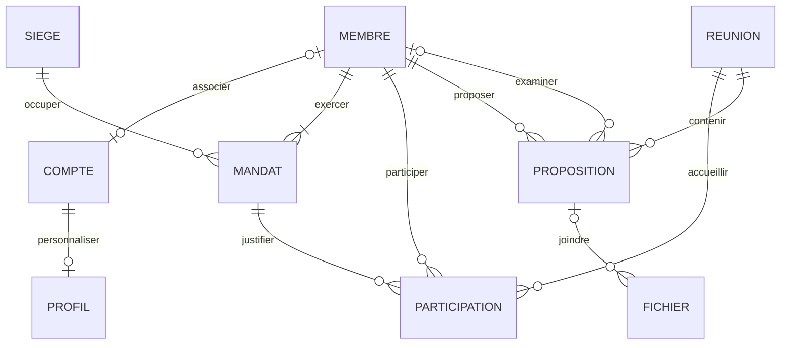
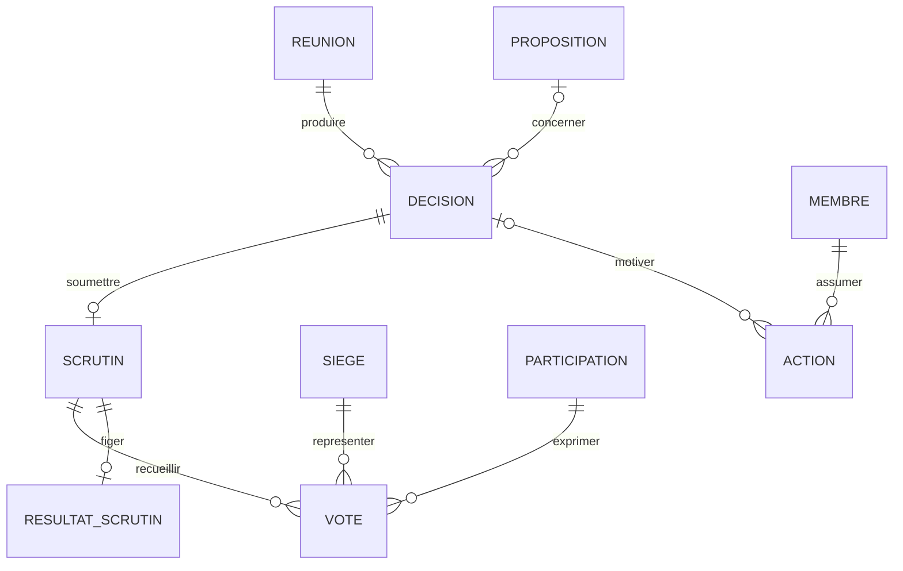
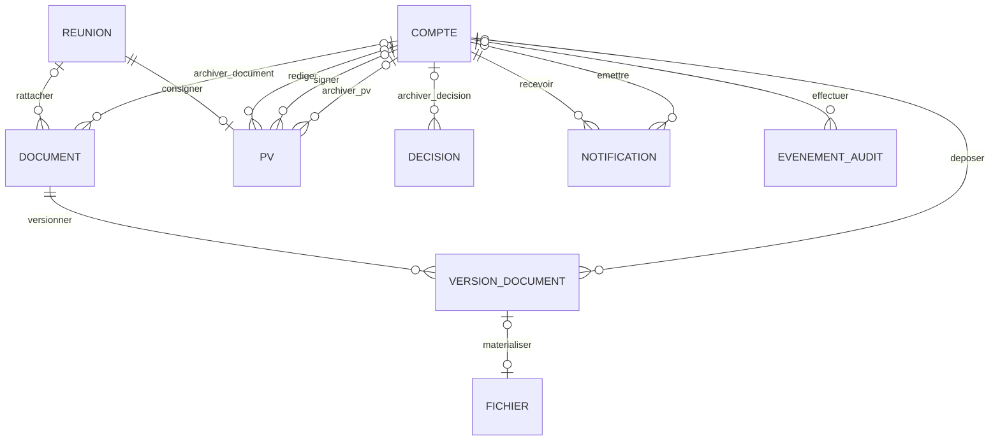

# Modèle conceptuel de données — Gestion du comité scientifique

**Projet :** Dev Rangers — Département d'informatique  
**Version :** V1.1 corrigée après revue Codex, à confirmer avant le MLD  
**Branche de référence :** `feat/integration-bdd`  
**Source analysée par Codex :** `9fde791c07bd9e0f171c2c8d4faf5ccd33f8189b`  
**Revue Codex :** `6b25f8fc4d2edf19e16059b69f3bc1fc1e008d02` (selon le rapport de revue, aucun changement de `src/` ni de `package.json` depuis la source analysée)  
**Périmètre :** un comité scientifique, notifications internes, persistance métier et historique.

## 1. Objet et sources

Le MCD décrit les objets métier, leurs propriétés et leurs associations, indépendamment de PostgreSQL et de Prisma. Les identifiants sont conceptuels ; les clés étrangères, types SQL, index et choix d'implémentation des instantanés seront définis dans le MLD et le schéma Prisma. Les 19 entités ci-dessous constituent une proposition de conception, et non une affirmation que 19 tables seront nécessaires.

Références : `ANALYSE_DES_DONNEES.md` (§2 à §8), `../ARCHITECTURE.md` (§7, §13), `../ROLES_ET_PERMISSIONS.md` (§4, §8), guide de simulation du workflow (étapes 1 à 15). Les constats du rapport Codex n'ont pas été revérifiés directement dans le dépôt. Les divergences et les choix V1 sont explicités en section 6. La revue Codex a confirmé les 19 entités et les 33 associations, et demandé de compléter les invariants du vote, de la décision et plusieurs règles conditionnelles. Ces corrections documentaires ne constituent pas des tests exécutés ni une nouvelle revue du dépôt.

## 2. Notation

Les diagrammes utilisent la notation entité-association (pattes de corbeau, compatible Mermaid/GitHub). Dans le tableau d'associations, les cardinalités sont exprimées selon Merise : près d'une entité, elles indiquent le nombre de fois qu'une occurrence de cette entité participe à l'association.

- `(0,1)` : facultatif, au maximum une occurrence ; `(1,1)` : exactement une.
- `(0,N)` : zéro à plusieurs ; `(1,N)` : au moins une.
- `PARTICIPATION` et `VOTE` sont des associations porteuses de propriétés, représentées comme entités associatives pour faciliter leur lecture.
- Les entités reprises dans plusieurs diagrammes représentent les mêmes objets, et non des copies.

## 3. Diagrammes conceptuels

### 3.1. Identité, mandats, réunions et ordre du jour

Le rôle du compte autorise les opérations ; la fonction, la qualité et la période du mandat déterminent la représentation métier. Les présences sont portées par les participations. Une proposition appartient à une réunion et possède un auteur ; le relecteur reste facultatif avant examen.

### 3.2. Décisions, scrutins et suivi

Le votant est identifié par sa participation à la réunion ; celle-ci désigne le membre et son mandat. Le siège porté par le vote doit correspondre au mandat applicable. Le résultat de clôture capture notamment les sièges actifs, leurs représentants et les présences, y compris les sièges actifs non représentés. Les décisions en attente peuvent ne pas encore avoir de scrutin ; les décisions définitives sans scrutin sont réservées à la reprise historique. Les actions autonomes restent possibles.

### 3.3. Documents, PV, notifications et traçabilité

Le document générique de type « Procès-verbal » et le PV métier restent distincts en V1 : aucun lien entre eux n'est établi dans le code analysé. Un fichier peut appartenir à une proposition ou matérialiser une version documentaire, mais pas les deux. Les références des notifications et des événements d'audit à un objet métier sont décrites en section 4. Les identités d'acteur facultatives pour les documents/PV permettent de reprendre les anciennes fixtures ; les nouvelles opérations authentifiées devront toujours enregistrer leur acteur.

## 4. Entités et propriétés conceptuelles

`id` désigne l'identifiant interne de chaque entité. Les propriétés ci-dessous comprennent les attributs utiles observés et les ajouts recommandés pour la persistance. Les propriétés d'association (auteur, réunion, siège, etc.) sont décrites en section 5 et ne sont pas répétées comme clés étrangères. Les détails de nullabilité, valeurs par défaut et types feront l'objet du dictionnaire de données.

| Entité | Propriétés métier principales | Rôle |
|---|---|---|
| COMPTE | id, prénom, nom, courriel de connexion, empreinte du mot de passe, rôle d'accès, actif, dates de création et modification | Authentification et autorisation. Le mot de passe en clair est exclu. |
| PROFIL | id, prénom/nom affichés, courriel de contact, téléphone, poste, département, biographie | Personnalisation indépendante du courriel d'authentification et du mandat. Les surcharges sont facultatives. |
| MEMBRE | id, nom complet, courriel, téléphone, notes | Annuaire ; indépendant du compte et des périodes de mandat. |
| SIEGE | id, libellé | Unité de représentation et de vote. |
| MANDAT | id, fonction, qualité titulaire/suppléant, date début, date fin | Historique des affectations. Le statut du mandat se calcule à une date de référence. |
| REUNION | id, titre, date, heure début/fin, salle, description, statut, date dernier envoi de convocations, démarrage, clôture | Préparation et déroulement d'une séance. |
| PARTICIPATION | id conceptuel (ou couple réunion/membre), présence (non renseignée, présent, absent), date de relevé facultative | Invitation et feuille de présence uniques, avec mandat de référence. |
| PROPOSITION | id, titre, description, date création, statut, ordre, note de revue, date de revue facultative | Ordre du jour collaboratif ; aucune copie persistante dans la réunion. |
| DECISION | id, référence, titre, description, date, statut, provenance du statut définitif (scrutin ou reprise historique, absente si en attente), date archivage, nom d'archiveur historique éventuel | Décision de séance, éventuellement soumise à un scrutin. |
| SCRUTIN | id, état, seuil quorum, seuil majorité, dates ouverture/clôture | Organisation d'un vote relatif à une décision. |
| VOTE | id conceptuel (ou couple scrutin/siège), choix, date de vote éventuelle | Expression d'un représentant éligible sur un siège. |
| RESULTAT_SCRUTIN | id, date de capture, seuils, version de règle, nombre de sièges actifs/représentés, minimum quorum, participation, pour/contre/abstention, déposés/non déposés/exprimés, quorum atteint, issue, représentation et présence historiques | Instantané définitif ; distingue les présents physiques et les représentants, et contient les identités et libellés historiques du titulaire, du suppléant et du représentant éventuels pour chaque siège actif, y compris les sièges sans représentant. |
| ACTION | id, titre, description, échéance, priorité, statut, ordre Kanban | Suivi d'une tâche avec responsable, décision facultative. |
| DOCUMENT | id, référence, titre, description, catégorie, statut, visibilité, date modification, date archivage, nom d'archiveur historique éventuel | Bibliothèque et archive documentaire. |
| VERSION_DOCUMENT | id, numéro, nom de fichier, note, date, nom d'auteur historique éventuel | Versions documentaires ; fichier binaire absent pour certaines anciennes fixtures. |
| FICHIER | id, nom original, taille, type MIME, référence de stockage privé, empreinte éventuelle, date de dépôt | Métadonnées et référence du fichier durable, pas le binaire dans le MCD. |
| PV | id, référence, résumé, suites/observations, statut, numéro de version, dates modification/soumission/retour/signature/archivage, motif de correction éventuel, noms historiques des acteurs, contenu officiel figé | Compte rendu unique par réunion, soumis, corrigé, signé, archivé. L'instantané reprend les éléments nécessaires à la version officielle. |
| NOTIFICATION | id, type, catégorie, priorité, titre, aperçu, détail, contexte, date création, date lecture/archivage éventuelles, clés de traduction, valeurs de template, clé de déduplication facultative, référence métier typée facultative, nom émetteur historique éventuel | Boîte individuelle interne ; les indicateurs lus/archivés dérivent des dates. |
| EVENEMENT_AUDIT | id, nature d'opération, date, type et identifiant historique de l'objet, détails utiles non sensibles | Journal des opérations sensibles, y compris les transitions du PV et les opérations système. |

### Domaines de valeurs

| Propriété | Valeurs fonctionnelles |
|---|---|
| Rôle d'accès | Administrateur (`admin`), Président, Secrétaire, Responsable archives (`archivist`), Membre |
| Fonction du mandat | Président, Secrétaire, Membre, Responsable archives, Administrateur (valeurs observées, distinctes du rôle d'accès) |
| Qualité du mandat | Titulaire, Suppléant |
| Statut de réunion | Planifiée, En cours, Clôturée, PV signé, Annulée |
| Présence | Non renseignée, Présent, Absent |
| Statut de proposition | Proposé, Validé, Rejeté |
| Statut de décision | En attente, Adoptée, Rejetée |
| État du scrutin | Ouvert, Clôturé |
| Choix de vote | Pour, Contre, Abstention |
| Issue du scrutin | Adoptée, Rejetée, Quorum non atteint (À voter est un affichage calculé pour un scrutin ouvert) |
| Statut / priorité d'action | À faire, En cours, Terminée / Basse, Normale, Haute |
| Catégorie / statut / visibilité documentaire | Ordre du jour, Procès-verbal, Rapport, Convocation, Autre / Brouillon, Validé, Archivé / Comité, Présidence, Archives |
| Statut de PV | Brouillon, À signer, Signé, Archivé ; le retour pour correction est un événement vers Brouillon |
| Types de notification | `convocation`, `reunion-modifiee`, `reunion-annulee`, `rappel-reunion`, `proposition-agenda`, `revue-agenda`, `echeance-action`, `action-attribuee`, `action-reattribuee`, `action-echeance-modifiee`, `rappel-action`, `action-en-retard`, `avis-decision`, `pv-signature`, `pv-correction`, `pv-signe`, `pv-archives` |

La provenance du statut définitif d’une décision vaut Scrutin ou Reprise historique ; elle est absente pour une décision en attente. La reprise historique est réservée à une procédure contrôlée de seed/import, non accessible aux mutations ordinaires.

Les catégories de notification sont `meetings`, `agenda`, `decisions`, `actions`, `minutes` ; les priorités sont `normale`, `importante`.

La cible d'une notification est une référence facultative composée d'un type (`meeting`, `agenda`, `decision`, `action`, `ballot`, `minutes`) et d'un identifiant ; les deux éléments sont présents ensemble ou tous deux absents ; elle désigne au plus un objet métier. Une cible doit exister au moment de l’émission ; si elle est ensuite retirée selon la politique de conservation, la référence historique est conservée et le lien n’ouvre plus de détail. Un objet peut être la cible de plusieurs notifications. La stratégie de référence polymorphe sera précisée au MLD ; les droits d'accès à l'objet doivent être contrôlés à chaque consultation. L'audit conserve une référence historique même si l'objet est retiré ; le journal n'enregistre jamais les secrets.

## 5. Associations et cardinalités (Merise)

Lire chaque ligne depuis l'entité A et depuis l'entité B : par exemple une réunion peut accueillir zéro à N participations, une participation appartient exactement à une réunion. Pour les relations entre compte et PV/document, les bornes facultatives reflètent la reprise possible de données anciennes ; les règles métier imposent l'acteur pour les nouvelles opérations.

| Entité A | Cardinalité A | Association | Cardinalité B | Entité B |
|---|:---:|---|:---:|---|
| MEMBRE | 0,1 | Est associé à | 0,1 | COMPTE |
| COMPTE | 0,1 | Possède | 1,1 | PROFIL |
| MEMBRE | 1,N | Exerce | 1,1 | MANDAT |
| SIEGE | 0,N | Est occupé par | 1,1 | MANDAT |
| REUNION | 0,N | Accueille | 1,1 | PARTICIPATION |
| MEMBRE | 0,N | Prend part via | 1,1 | PARTICIPATION |
| MANDAT | 0,N | Justifie | 1,1 | PARTICIPATION |
| REUNION | 0,N | Contient | 1,1 | PROPOSITION |
| MEMBRE | 0,N | Propose | 1,1 | PROPOSITION |
| MEMBRE | 0,N | Examine | 0,1 | PROPOSITION |
| PROPOSITION | 0,N | Comporte | 0,1 | FICHIER |
| REUNION | 0,N | Produit | 1,1 | DECISION |
| PROPOSITION | 0,N | Donne lieu à | 0,1 | DECISION |
| DECISION | 0,1 | Fait l'objet de | 1,1 | SCRUTIN |
| SCRUTIN | 0,N | Recueille | 1,1 | VOTE |
| SIEGE | 0,N | Est représenté par | 1,1 | VOTE |
| PARTICIPATION | 0,N | Exprime | 1,1 | VOTE |
| SCRUTIN | 0,1 | Fige | 1,1 | RESULTAT_SCRUTIN |
| DECISION | 0,N | Motive | 0,1 | ACTION |
| MEMBRE | 0,N | Est responsable de | 1,1 | ACTION |
| REUNION | 0,N | Possède | 0,1 | DOCUMENT |
| DOCUMENT | 0,N | Est versionné en | 1,1 | VERSION_DOCUMENT |
| VERSION_DOCUMENT | 0,1 | Est matérialisée par | 0,1 | FICHIER |
| COMPTE | 0,N | Dépose | 0,1 | VERSION_DOCUMENT |
| COMPTE | 0,N | Archive | 0,1 | DOCUMENT |
| COMPTE | 0,N | Archive | 0,1 | DECISION |
| REUNION | 0,1 | Est consignée dans | 1,1 | PV |
| COMPTE | 0,N | Rédige | 0,1 | PV |
| COMPTE | 0,N | Signe | 0,1 | PV |
| COMPTE | 0,N | Archive | 0,1 | PV |
| COMPTE | 0,N | Reçoit | 1,1 | NOTIFICATION |
| COMPTE | 0,N | Émet | 0,1 | NOTIFICATION |
| COMPTE | 0,N | Effectue | 0,1 | EVENEMENT_AUDIT |

Contrainte d'exclusion : un FICHIER rattaché appartient soit à une PROPOSITION, soit à une VERSION_DOCUMENT, exactement une des deux. Le stockage temporaire avant rattachement relève de l'implémentation et n'est pas une occurrence métier définitive.

## 6. Règles métier et arbitrages proposés

Les règles marquées « choix V1 » précisent des points non arrêtés dans le rapport. Elles ne sont pas des exigences certifiées du professeur. Les règles observées proviennent principalement de `ANALYSE_DES_DONNEES.md` (§4 et §7).

| Domaine | Règle à retenir |
|---|---|
| Identité | Courriel normalisé unique par périmètre (compte et annuaire distincts). Un membre a au plus un compte. Tout compte non-admin doit être lié à un membre. Le rôle d'accès reste distinct de la fonction du mandat. **Choix V1 :** désactivation plutôt que suppression physique de tout compte, pour conserver les auteurs, destinataires et signataires historiques ; révoquer les sessions et refuser les accès d’un compte inactif. Un admin au moins reste actif : sérialiser les opérations de désactivation et de changement de rôle (verrou commun ou transaction sérialisable avec reprise sur conflit), puis vérifier l’invariant avant validation de la transaction. |
| Mandats | Dates inclusives, début ≤ fin. Pas de chevauchement même siège/même qualité ; titulaire et suppléant peuvent coexister. Pas de chevauchement des fonctions Président, Secrétaire et Responsable archives, même sur des sièges différents (observé). **Choix V1 :** pas de mandats parallèles pour une même personne ; une fiche membre possède au moins un mandat, créé avec elle. Un mandat référencé par une participation à une séance démarrée (ou par un historique définitif) ne peut plus être réécrit ni supprimé ; les renouvellements créent un nouveau mandat. Avant démarrage, une correction n’est possible qu’après revalidation transactionnelle des participations futures et des contraintes de chevauchement ; toute modification qui invaliderait une référence historique est refusée. |
| Participation | Une seule participation par réunion et membre ; le mandat de référence appartient à ce membre et couvre la date de réunion. Les changements légitimes de date ou de mandat revalident les participations des réunions planifiées. Président et secrétaire seuls relèvent les présences pendant une réunion en cours. Présence courante unique, non renseignée distincte d'absent. Un changement de présence ou d’éligibilité invalide et retire les votes concernés dans les scrutins ouverts, dans la même transaction ; après clôture de la réunion, les présences sont verrouillées. Les résultats de scrutins clos ne changent jamais. |
| Réunion | Secrétaire seul pour créer, modifier une réunion planifiée et envoyer/renvoyer les convocations internes aux comptes actifs des participants. Président seul pour démarrer et clôturer. Planifiée → En cours → Clôturée → PV signé (dernière transition par signature du PV). Démarrage si informations complètes, au moins un participant et un point validé. Clôture si aucun scrutin ouvert. Les horaires d'une même journée sont ordonnés. **Choix V1 :** fuseau métier `Africa/Algiers`, pas de réunion traversant minuit ni réouverture. Seul le secrétaire peut passer de Planifiée à Annulée (`CANCELLED`). Le statut existant suffit et les comptes actifs des participants déjà convoqués reçoivent un avis interne. La consultation respecte les invitations et les accès métier existants. |
| Agenda | Président, secrétaire et membre proposent sous leur identité liée. L’auteur peut modifier sa propre proposition proposée ou rejetée tant que la réunion est planifiée. Le président seul valide ou rejette les propositions, y compris celles du secrétaire. Tout rejet exige un motif non vide après retrait des espaces en début et en fin, conservé dans la note de revue. Seul l’auteur peut retirer une proposition de son cru, proposée ou rejetée et sans référence métier, tant que la réunion est planifiée. La revue identifie son acteur. Seuls les points validés constituent l’ordre du jour officiel. Seul le président peut les réordonner tant que la réunion est planifiée. Les proposés restent consultables séparément. Rejet et revue conservés. **Choix V1.** Verrouiller les points après démarrage sur tous les parcours, et préserver les points référencés. |
| Vote | Président seul pour ouvrir et clôturer un scrutin ; réunion en cours et décision en attente sans scrutin préalable à l’ouverture. Un scrutin par décision ; un seul vote par siège et par membre dans le scrutin. Le compte authentifié, actif, de rôle président, secrétaire ou membre correspond au membre de la participation du votant. La participation appartient exactement à la réunion de la décision du scrutin ; son mandat appartient à ce même membre, couvre la date de séance et occupe le siège porté par le vote. Le participant est présent et représente effectivement ce siège. Titulaire actif présent prioritaire ; sinon suppléant actif présent. **Choix V1 :** un suppléant actif peut représenter un siège sans titulaire actif, comme l’algorithme observé, sous réserve du règlement du comité. Un votant peut modifier ou retirer son propre vote uniquement tant que le scrutin et la réunion sont ouverts/en cours. Toute perte de présence ou de représentation retire les votes devenus invalides des scrutins ouverts dans la même transaction. Le service conserve l’identité des votes pour le calcul. La consultation présente le vote propre et les résultats agrégés autorisés, sans exposer les choix nominatifs des autres membres. Pas de second tour ni de réouverture en V1. Tous les votes et paramètres sont immuables après clôture. |
| Calcul et clôture | Quorum sur les sièges actifs, même non invités ; minimum = plafond(sièges actifs × seuil / 100). Quorum atteint si le nombre de sièges actifs est strictement positif ET si les sièges représentés atteignent le minimum. Majorité strictement supérieure au seuil sur pour + contre ; abstentions exclues ; égalité ou zéro exprimé ne permet pas l'adoption. Seuils 1 à 100 ; 100 % strict ne permet jamais d'adoption (comportement observé, conservé en V1). Aucun résultat définitif pour un scrutin ouvert ; exactement un résultat immuable pour un scrutin clos. La capture distingue la présence physique (membres présents, y compris les suppléants présents non représentants) des représentations par siège actif : titulaire, suppléant, représentant éventuels, identifiants et libellés figés ; conserve les paramètres et les décomptes. Clôture avec quorum : décision adoptée si majorité atteinte, rejetée sinon. Sans quorum : décision reste En attente, visible et signalée comme bloquée (état dérivé du résultat clos), non éligible à un second scrutin, à une action liée ou à l’archivage définitif. Clôture, résultat, décision, audit et notifications atomiques. |
| Décisions | Réunion obligatoire, lien facultatif vers une proposition de la même réunion. Le président seul crée une décision en attente pendant une séance en cours. Toute nouvelle décision devient adoptée ou rejetée exclusivement par clôture d’un scrutin avec quorum, avec la provenance Scrutin. Le seed et les imports contrôlés peuvent reprendre des décisions définitives historiques sans scrutin, marquées Reprise historique et tracées dans l’audit, en préservant les données inconnues. Sans quorum, la décision reste en attente. Une décision ayant des actions liées doit rester adoptée. Les décisions définitives sont immuables hors métadonnées d’archivage. |
| Actions | Responsable membre obligatoire et décision facultative. Si liée, la décision est adoptée et l’échéance est au moins égale à sa date. La décision liée reste adoptée. Le président et le secrétaire créent, modifient, attribuent, réattribuent et suppriment les actions selon les règles de conservation. Une action figurant dans l’instantané d’un PV signé ne peut être supprimée, même après archivage du PV. Ils peuvent changer le statut et l’ordre de toutes les cartes Kanban. Un compte de rôle membre affecté modifie uniquement le statut de sa propre action. Le suivi continue après clôture et archivage, dans le respect de la capture du PV signé. |
| Documents | Seul le secrétaire peut créer un document, modifier un document non archivé et y déposer une nouvelle version. Le secrétaire seul valide un document ordinaire de Brouillon à Validé, sans circuit d’approbation supplémentaire. Lui seul attribue et modifie la visibilité des documents non archivés parmi Comité, Présidence et Archives. Un document peut être créé sans version et sans fichier. Une nouvelle version exige un fichier durable privé, un auteur authentifié et un numéro unique dans le document ; version sans fichier réel tolérée uniquement pour reprise historique. Maximum cinq pièces par proposition, 10 Mio par fichier selon les formulaires observés. **Choix V1 :** stockage serveur privé sur volume persistant Docker, métadonnées en PostgreSQL. Pour tous les comptes actifs ayant accès au module : visibilité Comité pour les cinq rôles ; Présidence pour admin, président, archiviste et secrétaire ; Archives pour admin, président et archiviste (matrice observée). Le même contrôle s’applique aux listes, détails, recherche, archives, téléchargements de toutes les versions et liens directs. Aucun rôle ne peut supprimer un document par une opération ordinaire. Un document archivé est immuable. |
| PV | Un par réunion. Secrétaire crée pendant une réunion en cours ou clôturée, rédige/modifie uniquement le brouillon. Soumission après clôture, résumé non vide et au moins un présent ; liste des présents issue de la feuille de la réunion. Président seul pour retourner À signer vers Brouillon (date et motif si fourni) ou signer une seule fois depuis À signer sur réunion clôturée. Signature et passage réunion à PV signé atomiques avec audit et notifications. **Choix V1 :** capture à la soumission, remplacée lors d’une resoumission ; capture signée immuable incluant notes, présences, décisions, résultats, actions, identités et libellés affichés, indépendamment de l’évolution des sources. Brouillon et À signer consultables par secrétaire et président ; Signé et Archivé consultables par les cinq rôles actifs selon le périmètre autorisé, y compris par lien direct ou export. Journal des transitions ; conservation de toutes les versions textuelles non retenue en V1. Signature métier authentifiée, non signature électronique qualifiée. |
| Archives | Date et acteur d'archivage. Archiviste seul ; PV signé et décisions définitives de séance clôturée ou PV signé, documents autorisés hors modification de séance en cours. La transition dédiée autorise l'archivage sans modifier le contenu figé. **Choix V1 :** pas de désarchivage des objets métier. Les archives conservent les droits de consultation, y compris pour documents et PV. La restauration d’une notification archivée est une opération distincte de la boîte personnelle, autorisée. |
| Notifications | Destinataire obligatoire, compte actif au moment de l'émission, émetteur facultatif (système). Seul le destinataire lit, marque lu/non lu, archive/restaure ou retire sa notification. Les dates de lecture/archivage représentent l’état courant ; remettre à non lu ou restaurer efface la date correspondante. Pas d’historique complet des lectures en V1. Déduplication par occurrence et destinataire ; un renvoi volontaire de convocation a un nouvel identifiant d’occurrence, une relance technique du même envoi réutilise le même. Type et identifiant de cible présents ensemble ou absents ensemble. Rappels 24 h réunion et 48 h action ; échéance d’action en fin de journée locale, notification de retard pour une action non terminée, dédupliquée par échéance et destinataire. Ciblage détaillé ci-dessous ; exécution réelle côté serveur hors périmètre MCD. |
| Historique | Journal append-only pour opérations sensibles, acteur obligatoire si action humaine nouvelle. Seul l’administrateur technique consulte le journal dans une liste chronologique en lecture seule. Aucun rôle ne peut modifier ou supprimer un événement. Références historiques protégées ; suppression physique de données référencées interdite par défaut. Aucune cascade destructrice sur votes, décisions, mandats, PV signés et audit. |

Les contrôles contextuels (rôle, mandat à la date, présence, statut, visibilité, transitions) seront implémentés dans les services backend transactionnels, complétés par les contraintes SQL adaptées. Le MCD ne prétend pas à lui seul garantir ces règles.

### 6.1. Destinataires des notifications internes

Les événements sont émis à l’issue d’une opération réussie, dans la même transaction que la mutation (ou via un événement durable transactionnel). Aucun courriel ni SMS. Les comptes destinataires sont actifs au moment de l’émission et associés aux personnes concernées si nécessaire. Pour les événements de rôle, **choix V1** : tous les comptes actifs du rôle concerné, plutôt que le premier compte trouvé par le prototype.

| Événement | Destinataires |
|---|---|
| Convocation / renvoi | Comptes des participants invités. |
| Modification d’une réunion après convocation | Union des anciens et nouveaux participants concernés. |
| Annulation | Comptes actifs des participants déjà convoqués à la réunion, une notification interne par destinataire. |
| Rappel réunion planifiée dans les 24 h | Comptes des participants. |
| Nouvelle proposition d’agenda | Président(s). |
| Validation ou rejet de proposition | Compte de l’auteur. |
| Décision devenue adoptée ou rejetée | Comptes des participants à la réunion ; une occurrence de publication par résultat. |
| Attribution d’action non terminée | Compte du responsable. |
| Réattribution | Comptes de l’ancien et du nouveau responsable, si actifs. |
| Modification d’échéance, rappel dans les 48 h ou retard | Compte du responsable de l’action non terminée. |
| Soumission / resoumission du PV | Président(s). |
| Retour pour correction du PV | Secrétaire(s). |
| Signature du PV | Secrétaire(s) ; notification distincte de disponibilité aux archivistes. |

Les événements identiques mais correspondant à deux mutations réelles distinctes ne doivent pas être confondus ; la clé de déduplication identifie l’occurrence et le destinataire, pas seulement le type. Les rappels se fondent sur l’occurrence de l’échéance ou de la réunion et le destinataire ; aucune répétition à chaque passage du planificateur. L’ouverture de la cible réapplique les droits d’accès à l’objet.

### 6.2. Exemples de validation conceptuelle

| Scénario | Résultat attendu |
|---|---|
| Titulaire absent, suppléant actif présent pour le même siège | Seul le suppléant vote ; si le titulaire devient présent, le vote du suppléant est retiré du scrutin ouvert. |
| Participation d’une autre réunion ou siège différent du mandat | Vote refusé malgré l’existence de chaque identifiant. |
| Aucun siège actif | Quorum non atteint, même si le minimum calculé vaut zéro. |
| 5 sièges actifs, seuil 60 %, 2 représentés | Minimum 3, quorum non atteint ; décision reste en attente, bloquée en V1. |
| Décision nouvelle sans scrutin, tentative de passage à Adoptée | Refus ; seule la reprise historique contrôlée permet un statut définitif sans scrutin. |
| Dernier administrateur actif désactivé simultanément avec un changement de rôle | Au moins un administrateur actif subsiste ; opération conflictuelle refusée ou rejouée. |
| PV soumis, retourné, corrigé, resoumis, signé puis archivé | Nouvelle capture à la resoumission ; capture signée conservée malgré les changements ultérieurs ; archive sans modification du contenu. |

## 7. Éléments volontairement non modélisés comme entités indépendantes

| Élément | Justification |
|---|---|
| Archives | Projection des documents, décisions et PV archivés. |
| Tableau de bord et statistiques courantes | Agrégats calculés sur les données métier. |
| Statut du mandat, retard d'action, nombre de notifications non lues | Valeurs dérivées de dates et états courants. |
| Présences du scrutin ouvert et du PV brouillon | Dérivées de PARTICIPATION ; les états historiques sont figés à leur étape respective. |
| Rôle du suppléant | Qualité du mandat, non rôle d'accès supplémentaire. |
| Référentiel de permissions | Cinq rôles fixes en V1, règles backend ; pas de RBAC dynamique. |
| Sessions | Choix du système d'authentification à coordonner avec le backend ; tables techniques éventuelles au MLD. |
| Révisions complètes du PV et outbox | Non retenues comme entités V1 ; événements d'audit et instantané officiel suffisent au périmètre proposé. Outbox éventuelle si traitement asynchrone. |
| Préférences d'interface, traductions, filtres, thèmes | État de présentation, hors données métier. |
| Comité / département | Périmètre mono-comité ; une extension multi-comité demanderait une évolution du modèle. |

## 8. Contrôles de validation avant MLD

| Contrôle | État après correction documentaire |
|---|---|
| Exhaustivité des 19 entités et cohérence des 33 associations / cardinalités | Confirmées par la revue Codex sur le HEAD indiqué ; diagrammes et cardinalités inchangés. |
| B1 — provenance du vote et invalidation en scrutin ouvert | Invariants explicites en section 6 ; traduction SQL et transactionnelle à définir au MLD. |
| B2 — provenance d’une décision définitive | Choix V1 proposé : scrutin obligatoire pour toute nouvelle décision définitive ; exception historique tracée ; absence de quorum bloquante. À confirmer par l’équipe. |
| Corrections complémentaires (comptes, mandats, quorum, permissions, documents, PV, notifications) | Intégrées en section 6 ; vérification ciblée de la version corrigée à réaliser. |
| Scénarios de simulation | Représentables conceptuellement ; exemples en section 6.2 ; tests d’exécution à réaliser après implémentation. |
| Format des captures et stockage binaire | Choix proposé pour le MLD : JSONB versionné pour résultat et PV, stockage privé sur volume Docker persistant. |
| Seed et reprise historique | À réaliser lors de l’implémentation : ne pas inventer dates/acteurs historiques manquants ; corriger ou exclure les fixtures incompatibles ; tracer les exceptions autorisées. |
| Types SQL, contraintes, identifiants et migrations | À définir au MLD et à l’implémentation Prisma : UUID, noms SQL snake_case, références métier uniques par domaine, dates civiles et horodatages adaptés. |

Les arbitrages applicatifs V1 portent notamment sur l’exception historique au scrutin, le blocage sans quorum, la vacance du siège, les permissions de lecture, la conservation des comptes et mandats, le format des captures, le stockage privé et le choix d’authentification. Les droits de revue de l’agenda, de création des décisions et de gestion des actions sont confirmés dans la [revue de cohérence](../REVUE_COHERENCE_FRONTEND_BDD.md). Consulter le MLD et les migrations pour les garanties de persistance.

**Statut** — Le MCD V1.1 sert de référence à la couche BDD livrée. Le [MLD](MLD.md) formalise sa traduction et les [tests BDD](TESTS_BDD.md) documentent la validation réalisée. Les arbitrages applicatifs restant à confirmer sont signalés dans le texte.
