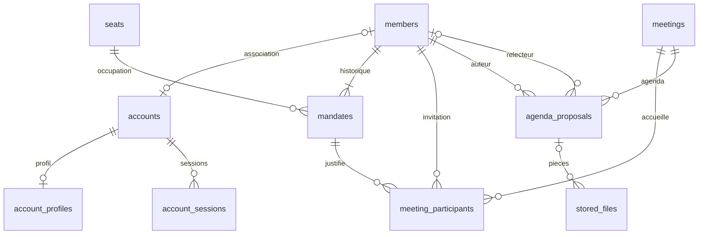
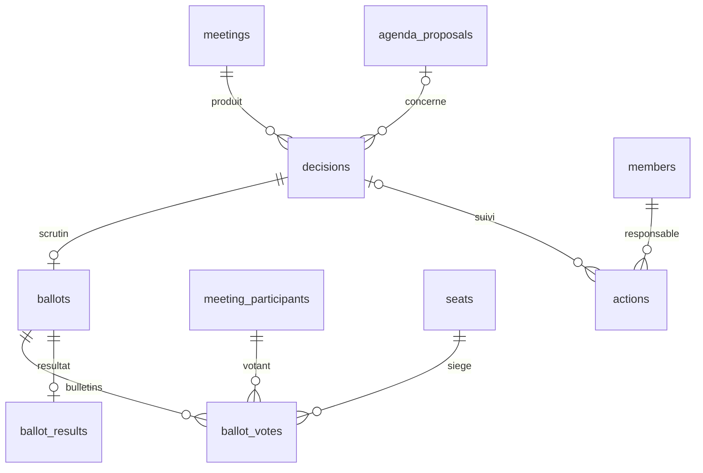
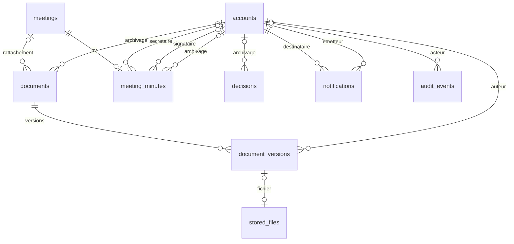

# Modèle logique de données — Gestion du comité scientifique

**Projet :** Dev Rangers — Département d'informatique  
**Version :** V1.1 — corrections ciblées après revue Codex  
**Branche :** `feat/integration-bdd`  
**Référence :** MCD V1.1 (fichier `MCD.md` après renommage), `ANALYSE_DES_DONNEES.md`, documentation des rôles et simulation du workflow.  
**Statut** — Le schéma Prisma et les sept migrations couvrent les 19 relations métier du MLD V1.1 et la table technique des sessions d’authentification.

## 1. Conventions

19 relations métier, mono-comité. Les noms SQL sont en anglais `snake_case`, les futurs modèles Prisma en `PascalCase`. Les identifiants internes sont des UUID, générés à la création ; les références métier affichées sont distinctes et uniques par domaine. Les dates civiles sont de type `date`, les heures de séance de type `time(0)` et les instants de type `timestamptz(3)` ; fuseau métier `Africa/Algiers`. Les chaînes libres utilisent `text`, les limites du formulaire sont contrôlées côté serveur et, si stable, en SQL. Les domaines fermés utilisent des enums (cf. §4). Les pourcentages de seuil utilisent `numeric(5,2)` pour conserver les valeurs décimales admises par le prototype, et le calcul serveur doit éviter les erreurs de frontière.

Notation : **PK** clé primaire ; **FK** clé étrangère ; **UQ** unicité ; `?` nullable ; les autres colonnes sont NOT NULL. Sauf mention, les FK référencent `id` de la table indiquée. Les identifiants simples `id` sont des UUID PK. Les colonnes et contraintes ci-dessous constituent le modèle relationnel de référence ; leurs types détaillés seront complétés dans le dictionnaire. Les noms des contraintes SQL pourront être adaptés à l'implémentation. Pas de suppression en cascade par défaut. Choisir explicitement ON DELETE RESTRICT et ON UPDATE RESTRICT (ou NO ACTION lorsque justifié) pour les FK de provenance et les autres liens protégés ; les UUID sont immuables. Une relation optionnelle peut être détachée par une mise à jour métier autorisée, et non par une action référentielle implicite. Les dates/acteurs historiques inconnus restent NULL lorsque permis, sans fabriquer de faits.

## 2. Relations et attributs

### 2.1 Identité et comité (5)

| Relation / modèle Prisma | Attributs | Clés et relations |
|---|---|---|
| `accounts` / Account | `id`, `first_name`, `last_name`, `email`, `password_hash`, `role`, `is_active`, `member_id?`, `created_at`, `updated_at` | PK id ; UQ email normalisé ; UQ member_id ; FK member_id → members |
| `account_profiles` / AccountProfile | `id`, `account_id`, `first_name?`, `last_name?`, `contact_email?`, `phone?`, `position?`, `department?`, `bio?` | PK id ; UQ account_id ; FK → accounts |
| `members` / Member | `id`, `full_name`, `email`, `phone?`, `notes?` | PK id ; UQ email normalisé |
| `seats` / Seat | `id`, `label` | PK id ; UQ label (choix logique V1) |
| `mandates` / Mandate | `id`, `member_id`, `seat_id`, `function`, `kind`, `start_date`, `end_date` | PK id ; FK member_id → members ; FK seat_id → seats ; UQ (id, member_id), UQ (id, seat_id) pour les FK composites de provenance |

Le compte non-admin doit être lié à un membre. Un membre peut exister sans compte et doit être créé avec au moins un mandat. Les surcharges du profil sont indépendantes des identifiants de connexion ; NULL signifie reprendre l'information du compte ou la valeur initiale de l'interface. Le siège actuel et le statut du mandat ne sont pas dupliqués.

### 2.2 Réunions et agenda (3)

| Relation / modèle Prisma | Attributs | Clés et relations |
|---|---|---|
| `meetings` / Meeting | `id`, `title`, `meeting_date`, `start_time`, `end_time`, `location`, `description`, `status`, `invitations_sent_at?`, `started_at?`, `closed_at?` | PK id |
| `meeting_participants` / MeetingParticipant | `id`, `meeting_id`, `member_id`, `mandate_id`, `attendance?` (boolean), `attendance_recorded_at?` | PK id ; UQ (meeting_id, member_id) ; FK meeting_id → meetings ; FK member_id → members ; FK (mandate_id, member_id) → mandates(id, member_id) ; UQ (id, meeting_id, mandate_id) |
| `agenda_proposals` / AgendaProposal | `id`, `meeting_id`, `author_member_id`, `reviewer_member_id?`, `title`, `description`, `created_at`, `status`, `sort_order?`, `review_note?`, `reviewed_at?` | PK id ; FK meeting_id → meetings ; FK author_member_id et reviewer_member_id → members ; UQ (id, meeting_id) |

Présence : NULL = non renseignée, true = présent, false = absent. La réunion n'a pas de tableau de participants, de présences ni d'agenda sérialisé. Les points officiels sont les propositions validées, triées par ordre (et un critère stable en cas d'égalité). Les pièces jointes sont rattachées via `stored_files.agenda_proposal_id`.

### 2.3 Décisions, votes et actions (5)

| Relation / modèle Prisma | Attributs | Clés et relations |
|---|---|---|
| `decisions` / Decision | `id`, `meeting_id`, `agenda_proposal_id?`, `reference`, `title`, `description`, `decision_date`, `status`, `final_source?`, `archived_at?`, `archived_by_account_id?`, `archived_by_name?` | PK id ; UQ reference ; FK meeting_id → meetings ; FK (agenda_proposal_id, meeting_id) → agenda_proposals(id, meeting_id) ; FK archived_by_account_id → accounts ; UQ (id, meeting_id) |
| `ballots` / Ballot | `id`, `decision_id`, `meeting_id`, `state`, `quorum_percent`, `majority_percent`, `opened_at?`, `closed_at?` | PK id ; UQ decision_id ; FK (decision_id, meeting_id) → decisions(id, meeting_id) ; UQ (id, meeting_id) |
| `ballot_votes` / BallotVote | `id`, `ballot_id`, `meeting_id`, `participation_id`, `mandate_id`, `seat_id`, `choice`, `voted_at?` | PK id ; UQ (ballot_id, seat_id) ; UQ (ballot_id, participation_id) ; FK (ballot_id, meeting_id) → ballots(id, meeting_id) ; FK (participation_id, meeting_id, mandate_id) → meeting_participants(id, meeting_id, mandate_id) ; FK (mandate_id, seat_id) → mandates(id, seat_id) |
| `ballot_results` / BallotResult | `id`, `ballot_id`, `captured_at?`, `quorum_percent`, `majority_percent`, `rule_version`, `active_seat_count`, `represented_seat_count`, `quorum_min_seats`, `participation_percent`, `for_count`, `against_count`, `abstain_count`, `votes_cast`, `uncast_count`, `expressed_count`, `quorum_reached`, `outcome`, `snapshot_version`, `representation_snapshot` (JSONB), `presence_snapshot` (JSONB) | PK id ; UQ ballot_id ; FK ballot_id → ballots |
| `actions` / CommitteeAction | `id`, `decision_id?`, `assignee_member_id`, `title`, `description`, `due_date`, `priority`, `status`, `sort_order` | PK id ; FK decision_id → decisions ; FK assignee_member_id → members |

**Provenance du vote (B1).** Les colonnes `meeting_id` de ballots et ballot_votes, ainsi que `mandate_id` de ballot_votes, sont des redondances contrôlées, ajoutées au niveau logique pour permettre les FK composites. Elles ne sont jamais choisies librement par le client. Elles garantissent l'égalité des réunions et la correspondance du siège avec le mandat. L'unicité d'une participation par réunion et membre rend UQ(ballot_id, participation_id) équivalente à l'unicité du votant dans le scrutin. Les FK ne suffisent pas à vérifier les dates, la présence, l'identité authentifiée et la priorité du titulaire ; le service doit les vérifier dans la transaction. Les UQ composites qui contiennent déjà id sont intentionnelles : PostgreSQL a besoin d'une clé candidate déclarée pour chaque cible de FK composite. Le lien conceptuel entre vote et siège est garanti transitivement par ballot_votes(mandate_id, seat_id) → mandates(id, seat_id), puis mandates.seat_id → seats.id ; aucune FK directe supplémentaire vers seats n’est requise. Pour le lien agenda facultatif, utiliser MATCH SIMPLE (comportement par défaut) et FK réunion obligatoire ; une proposition renseignée doit être de la même réunion. Définir ON DELETE RESTRICT et ON UPDATE RESTRICT sur cette FK composite : un SET NULL global toucherait meeting_id, obligatoire. Pour détacher une proposition, si le métier le permet, mettre explicitement agenda_proposal_id à NULL sans modifier meeting_id.

**Provenance de la décision (B2).** `final_source` = BALLOT ou HISTORICAL_IMPORT pour un statut définitif, NULL si PENDING. La provenance historique est réservée à la reprise contrôlée, avec audit. Le résultat QUORUM_NOT_REACHED implique une décision PENDING bloquée ; pas de second scrutin ni de réouverture V1. Une action autonome reste possible ; une action liée exige une décision ADOPTED. Aucun champ `blocked` n'est nécessaire : déduire le blocage du scrutin fermé et du résultat sans quorum. Les résultats ouverts sont calculés, jamais persistés en tant que résultats définitifs.

### 2.4 Documents, fichiers et procès-verbaux (4)

| Relation / modèle Prisma | Attributs | Clés et relations |
|---|---|---|
| `documents` / Document | `id`, `meeting_id?`, `reference`, `title`, `description`, `type`, `status`, `visibility`, `updated_at?`, `archived_at?`, `archived_by_account_id?`, `archived_by_name?` | PK id ; UQ reference ; FK meeting_id → meetings ; FK archived_by_account_id → accounts |
| `document_versions` / DocumentVersion | `id`, `document_id`, `number`, `filename`, `note`, `version_date?` (date), `author_account_id?`, `author_name?`, `is_historical` | PK id ; UQ (document_id, number) ; FK document_id → documents ; FK author_account_id → accounts |
| `stored_files` / StoredFile | `id`, `agenda_proposal_id?`, `document_version_id?`, `original_name`, `size_bytes`, `mime_type`, `storage_key`, `checksum?`, `uploaded_at` | PK id ; FK agenda_proposal_id → agenda_proposals ; FK document_version_id → document_versions ; UQ document_version_id ; UQ storage_key ; CHECK exactement un des deux rattachements non NULL |
| `meeting_minutes` / MeetingMinutes | `id`, `meeting_id`, `reference`, `summary`, `next_steps`, `status`, `version`, `updated_at?`, `submitted_at?`, `returned_at?`, `signed_at?`, `archived_at?`, `correction_note?`, `secretary_account_id?`, `signed_by_account_id?`, `archived_by_account_id?`, `secretary_name?`, `president_name?`, `signed_by_name?`, `archived_by_name?`, `snapshot_version?`, `official_snapshot?` (JSONB) | PK id ; UQ meeting_id ; UQ reference ; FK meeting_id → meetings ; les trois FK d'acteur → accounts |

Un document peut ne pas avoir de version. Une nouvelle version doit avoir exactement un fichier durable et un auteur authentifié, ce qui exige une transaction service (la FK de `stored_files` seule garantit au plus un fichier). `is_historical` est un indicateur technique ajouté pour la reprise de versions anciennes sans fichier ; seuls import/seed contrôlés peuvent l'utiliser. Un fichier a exactement un propriétaire métier (proposition ou version), sans table de jointure supplémentaire. Les fichiers ne sont pas publics ; `storage_key` est une clé relative opaque, pas un lien public. Les fixtures ne contenant que des noms de fichiers ne doivent pas produire de faux binaires. Les métadonnées de stockage ne constituent pas une preuve que le fichier existe : contrôles et compensation côté serveur nécessaires.

PV : la présence du brouillon dérive des participations. L'instantané officiel est produit à la soumission et remplacé à la resoumission, puis verrouillé à la signature. Les anciens PV signés ne peuvent être importés qu'avec un instantané reconstitué à partir des données réellement connues et signalé comme reprise ; si l'information indispensable manque, exclure la fixture et documenter pourquoi. Les dates d'événements historiques au jour seulement ne doivent pas être converties en instants prétendument exacts : garder NULL pour l'instant inconnu et conserver la date source avec sa précision dans le snapshot ou les détails d'audit. Le nom du président prévu au PV ne remplace pas l'identité du signataire. La signature et l'archivage sont des opérations distinctes. Le PV métier et un document de type MINUTES restent distincts.

### 2.5 Notifications et audit (2)

| Relation / modèle Prisma | Attributs | Clés et relations |
|---|---|---|
| `notifications` / Notification | `id`, `recipient_account_id`, `sender_account_id?`, `sender_name?`, `kind`, `category`, `priority`, `title`, `preview`, `detail`, `context`, `created_at`, `read_at?`, `archived_at?`, `deleted_at?` (timestamptz(3)), `title_key?`, `message_key?`, `template_values?` (JSONB), `dedupe_key?`, `target_type?`, `target_id?` (UUID) | PK id ; FK recipient_account_id et sender_account_id → accounts ; UQ (recipient_account_id, dedupe_key) ; CHECK cible complète ou absente |
| `audit_events` / AuditEvent | `id`, `actor_account_id?`, `operation`, `occurred_at`, `entity_type`, `entity_id` (UUID), `details?` (JSONB) | PK id ; FK actor_account_id → accounts ; référence historique de l'objet sans FK polymorphe |

Les notifications et l'audit utilisent des références polymorphes (couple type/UUID) : le service vérifie l'existence de la cible au moment de l'émission, puis conserve sa référence même si la cible est retirée. Les liens d'interface sont dérivés du type et l'autorisation est revérifiée au clic. Les dates read_at/archived_at décrivent l'état courant : effacement de la date = non lu/restauré. Le retrait par le destinataire est logique : renseigner deleted_at (instant réel du retrait, NULL initialement) et conserver la ligne et sa clé. Une notification retirée est exclue de toutes les vues utilisateur, y compris archives personnelles, détail, cloche et compteurs ; elle n’est ni restaurable ni modifiable via les opérations ordinaires en V1. La restauration d’une notification seulement archivée reste possible si deleted_at est NULL. La clé de déduplication est déterministe par occurrence, et l'unicité est définie par destinataire sur toutes les lignes, y compris retirées ; NULL est accepté pour des notifications sans déduplication. Toute relance technique réutilise la clé d’origine et ne réactive pas une ligne retirée ; un nouvel événement réel ou renvoi volontaire utilise une nouvelle clé. Pas de purge physique des lignes portant une clé de déduplication en V1 ; toute politique de rétention ultérieure devra conserver une trace durable des émissions. Ce champ technique traduit le retrait prévu au MCD §6 sans créer une nouvelle entité. Le journal d'audit est append-only, sans secret ni mot de passe, et doit être protégé contre les mutations ordinaires. Les événements d'import peuvent être système, avec date réelle d'import (distincte de la date historique inconnue).

### 2.6 Sessions d’authentification (1 table technique)

| Relation / modèle Prisma | Attributs | Clés et relations |
|---|---|---|
| `account_sessions` / `AccountSession` | `id`, `account_id` (UUID), `token_hash` (text), `created_at`, `expires_at` (timestamptz(3)) | PK id ; FK account_id → accounts avec `RESTRICT` en suppression et en mise à jour ; UQ token_hash |

Un compte peut avoir zéro à plusieurs sessions. Chaque session référence un compte et contient une empreinte SHA-256 en hexadécimal minuscule. Les instants de création et d’expiration sont finis et l’expiration est strictement postérieure à la création. La suppression d’une session assure sa révocation.

## 3. Diagrammes relationnels

Les relations ci-dessous montrent les liens logiques ; les compositions exactes des FK, nullabilités et contraintes figurent en §2. Une flèche de cardinalité ne remplace pas une contrainte SQL ou un contrôle de service.

## 4. Domaines de valeurs

Les codes stables ci-dessous sont une convention technique ; le frontend utilise un mapping vers ses valeurs existantes et les libellés FR/EN/AR. Ne pas utiliser les libellés traduits comme clés de persistance. Les valeurs de notification existantes en kebab-case sont conservées au niveau logique (mapping Prisma enum possible).

| Domaine | Valeurs |
|---|---|
| AccountRole | ADMIN, PRESIDENT, SECRETARY, ARCHIVIST, MEMBER |
| MandateFunction | PRESIDENT, SECRETARY, MEMBER, ARCHIVIST, ADMIN |
| MandateKind | TITULAR, SUBSTITUTE |
| MeetingStatus | PLANNED, IN_PROGRESS, CLOSED, MINUTES_SIGNED, CANCELLED |
| AgendaStatus | PROPOSED, APPROVED, REJECTED |
| DecisionStatus | PENDING, ADOPTED, REJECTED |
| DecisionFinalSource | BALLOT, HISTORICAL_IMPORT |
| BallotState | OPEN, CLOSED |
| VoteChoice | FOR, AGAINST, ABSTAIN |
| BallotOutcome | ADOPTED, REJECTED, QUORUM_NOT_REACHED |
| ActionStatus | TODO, IN_PROGRESS, DONE |
| ActionPriority | LOW, NORMAL, HIGH |
| DocumentType | AGENDA, MINUTES, REPORT, INVITATION, OTHER |
| DocumentStatus | DRAFT, APPROVED, ARCHIVED |
| DocumentVisibility | COMMITTEE, PRESIDENCY, ARCHIVES |
| MinutesStatus | DRAFT, TO_SIGN, SIGNED, ARCHIVED |
| NotificationKind | convocation, reunion-modifiee, reunion-annulee, rappel-reunion, proposition-agenda, revue-agenda, echeance-action, action-attribuee, action-reattribuee, action-echeance-modifiee, rappel-action, action-en-retard, avis-decision, pv-signature, pv-correction, pv-signe, pv-archives |
| NotificationCategory | meetings, agenda, decisions, actions, minutes |
| NotificationPriority | normale, importante |
| NotificationTargetType | meeting, agenda, decision, action, ballot, minutes |

## 5. Intégrité et transactions

### 5.1 Contraintes déclaratives PostgreSQL

En plus des PK, FK et UQ de §2 :

| Domaine | Contraintes proposées |
|---|---|
| Identité | Courriels non vides, trim et minuscules avant insertion ; CHECK de forme canonique + UQ ; compte non-admin implique member_id non NULL. Le profil et le courriel d'annuaire restent distincts. |
| Mandats | CHECK start_date <= end_date ; exclusions de chevauchement sur daterange(start_date,end_date,'[]') pour (seat_id,kind), pour member_id, et pour function limitée à PRESIDENT, SECRETARY, ARCHIVIST. Activer l’extension btree_gist avant les exclusions, pour les opérateurs d’égalité des clés UUID et enums associés aux plages GiST. |
| Réunion | CHECK start_time < end_time ; dates de démarrage/clôture cohérentes si connues ; état initial PLANNED pour les nouvelles réunions. |
| Agenda | Ordre NULL ou entier non négatif ; relecteur requis pour toute nouvelle validation/rejet ; ne pas imposer de relecteur inventé aux fixtures historiques. |
| Décision | CHECK (PENDING et provenance NULL) ou (ADOPTED/REJECTED et provenance non NULL) ; archivage possible uniquement si définitive ; références uniques. |
| Scrutin | Seuils entre 1 et 100, date ouverture <= clôture si connue ; vote unique par siège et participation. |
| Résultat | Compteurs non négatifs, représentés <= actifs, pour + contre = exprimés, exprimés + abstentions = déposés, déposés + non déposés = représentés ; minimum = ceil(actifs * quorum / 100) ; quorum atteint ssi actifs > 0 et représentés >= minimum ; pourcentage de participation = arrondi(100 * représentés / actifs) ou 0 ; issue cohérente avec quorum, exprimés et majorité stricte. Les seuils de la capture doivent correspondre à ceux du scrutin à la clôture (service). |
| Actions | Ordre entier non négatif ; responsable obligatoire. |
| Versions et fichiers | Numéro > 0 ; taille 0 à 10 Mio (limite V1), clé privée unique, exactement un propriétaire ; auteur requis si version non historique. |
| Documents/PV | Statut archivé implique date d'archivage et réciproquement ; versions PV > 0 ; snapshot_version et official_snapshot présents ensemble ; PV TO_SIGN, SIGNED ou ARCHIVED exige capture ; nouvelles signatures et archives exigent compte et instant authentifiés. Pour reprise ancienne, utiliser les données connues et documenter les exceptions au niveau service/import, sans inventer d'acteur. Si une date d'archivage n'est connue qu'au jour et que le CHECK exige un instant, exclure la fixture ou faire évoluer explicitement le modèle de précision avant import. |
| Notifications | CHECK (target_type IS NULL) = (target_id IS NULL) ; unique de déduplication sur toutes les lignes (pas un index unique partiel excluant les lignes retirées) ; FK destinataire obligatoire. deleted_at nullable ; retrait logique terminal dans le service. |

La dernière ligne de défense des contraintes SQL sera implémentée dans les migrations. Les `CHECK` et exclusions non représentables directement dans le DSL Prisma seront ajoutés en SQL personnalisé, versionnés et testés sur une base vierge. Vérifier les FK composites avec la version Prisma retenue, en particulier les champs partagés entre relations, les cibles UQ, le mapping des noms et les actions référentielles explicites. Utiliser le mode de relations foreignKeys. Si le partage de champs de relation est problématique, adapter le mapping et conserver les invariants via migration SQL personnalisée documentée, plutôt que de supprimer les protections ; contrôler également que les migrations ultérieures ne les retirent pas. Aucun SET NULL global sur la FK décision–proposition qui contient meeting_id obligatoire. Les contraintes inter-tables/états historiques ne sont pas des CHECK de ligne ordinaires.

### 5.2 Règles transactionnelles à remettre au responsable backend

| Opération | Invariant et frontière transactionnelle |
|---|---|
| Compte / mandat | Au moins un admin actif (sérialiser mutations de rôle/activation et revérifier) ; création membre + mandat ; modification de mandat et validation de toutes les participations affectées ; protéger les mandats liés à une séance démarrée ou à l'historique. |
| Réunion / agenda | Le secrétaire planifie, convoque et annule les réunions planifiées en utilisant le statut existant `CANCELLED`. Enregistrer la transition, l’audit et les notifications internes aux comptes actifs déjà convoqués dans une transaction. Les lectures de réunion respectent les invitations et les accès métier existants. Le président, le secrétaire, les titulaires et les suppléants peuvent consulter les propositions d’autrui, quel que soit leur état, dans les réunions auxquelles ils ont accès. Les droits d’écriture restent soumis à leurs propres conditions. Le président démarre avec au moins un participant et un point validé et clôture uniquement sans scrutin ouvert. Lui seul valide ou rejette les propositions, y compris celles du secrétaire. Le serveur exige pour tout rejet un motif non vide après retrait des espaces en début et en fin. Seul le président peut réordonner les points validés pendant la planification. Seul l’auteur peut retirer sa propre proposition `PROPOSED` ou `REJECTED` non référencée en réunion `PLANNED`. Le serveur contrôle auteur et relecteur, transitions et verrouillage des données de séance. |
| Présences / votes | Président ou secrétaire modifie présence uniquement en séance en cours ; date couverte par le mandat ; vérifier compte actif de rôle PRESIDENT, SECRETARY ou MEMBER pour voter, identité du membre, même réunion, siège, présence et représentation ; titulaire prioritaire. Seul l’auteur peut déposer, modifier ou retirer son vote tant que la réunion est IN_PROGRESS et le scrutin OPEN ; exception système pour retirer les votes devenus invalides dans les scrutins ouverts lors d’une perte d’éligibilité, dans la même transaction. La lecture expose le vote propre et les résultats agrégés autorisés. Aucun rôle ne peut consulter les choix nominatifs des autres votants. |
| Ouverture scrutin | Président seul ; réunion IN_PROGRESS, décision PENDING et aucun scrutin préalable pour cette décision (y compris clos sans quorum). Créer OPEN avec seuils valides et sans résultat définitif, dans une transaction protégeant contre une ouverture concurrente. |
| Clôture scrutin | Président seul ; réunion IN_PROGRESS et scrutin OPEN. Verrouiller le contexte réunion/scrutin ; calculer à partir d'une vue cohérente des présences/mandats/votes ; enregistrer exactement un résultat et faire passer le scrutin à CLOSED, mettre à jour la décision, audit et notifications dans la même transaction. Aucun changement des paramètres, aucune réouverture ou suppression du scrutin clos ; aucune insertion, modification ou suppression de vote ou résultat après clôture. Le résultat est créé une seule fois par la transaction de clôture, avec exception réservée à l’import historique contrôlé, jamais via un CRUD ordinaire. |
| Décisions / actions | Le président seul crée la décision en attente pendant la séance. La provenance définitive résulte de la clôture avec quorum ou d’un import historique tracé. Si une action est liée, la décision doit rester adoptée et sa date précéder l’échéance ou lui être égale. Le président et le secrétaire ont les mêmes droits de gestion des actions, dont modification, réattribution, suppression selon conservation et déplacement des cartes. Le service refuse la suppression de toute action référencée dans l’instantané d’un PV signé ou archivé et sérialise ce contrôle avec la signature. Le membre affecté modifie uniquement le statut de sa propre action. Les droits et le réordonnancement concurrent relèvent des services. |
| Fichiers / documents | Seul le secrétaire peut créer un document, modifier un document non archivé et y déposer une nouvelle version. Seul le secrétaire valide un document ordinaire (`DRAFT` → `APPROVED`) et attribue ou modifie la visibilité des documents non archivés (`COMMITTEE`, `PRESIDENCY`, `ARCHIVES`). Aucun rôle ne peut supprimer un document par une opération ordinaire. Limiter à cinq fichiers par proposition et vérifier taille/contenu ; nouvelle version + métadonnées + fichier durable, numéro concurrent protégé ; gérer compensation entre stockage et BDD en cas d'échec ; vérifier visibilité sur tous les chemins (liste/détail/recherche/archive/téléchargement) ; documents archivés immuables. |
| PV | Création secrétaire en réunion en cours/clôturée ; soumission après clôture, résumé non blanc et au moins un présent ; capture à la soumission et remplacement à la resoumission ; retour vers DRAFT ou signature par le président depuis TO_SIGN ; signature unique de la capture soumise et mise à jour réunion, audit, notifications atomiques ; capture signée immuable ; interdire toute suppression de PV SIGNED ou ARCHIVED et toute modification de leur contenu ; seule la transition dédiée SIGNED → ARCHIVED et ses métadonnées sont autorisées. |
| Archives | Archiviste seul ; PV signé, décision définitive de séance clôturée ou PV signé, document autorisé ; archivage ne modifie pas le contenu historique ; pas de désarchivage métier. |
| Notifications / audit | Émission ciblée par événement conformément au MCD §6.1, dans transaction métier ou via événement durable ; clés d'occurrence idempotentes, rappels 24h/48h et retard ; seul destinataire modifie son état ; retrait logique terminal conservant la clé ; relance technique sans réactivation ; audit append-only. Seul l’administrateur technique accède à la liste du journal en lecture seule. Aucun rôle ne peut modifier ni supprimer un événement. |

Pour prévenir les courses, convenir avec le backend d'un ordre commun de verrouillage des lignes (notamment réunion avant scrutin puis résultats), ou utiliser des transactions SERIALIZABLE avec retry sur conflit. La protection du dernier admin exige une stratégie spécifique commune à toutes les opérations concernées. Les garanties historiques sont obligatoires dans les services, et pourront être renforcées par triggers et droits SQL si retenu ; aucun CRUD direct ne doit les contourner. Les tests doivent couvrir INSERT/UPDATE/DELETE des votes et résultats après clôture, suppression du scrutin clos, suppression des PV signés/archivés, et réémission d’une notification retirée. Si des triggers sont retenus, leur ordre doit permettre la création atomique du résultat avant le passage à CLOSED sans rendre possible un résultat prématuré en état stable ; prévoir une procédure d’import historique contrôlée. Les transitions doivent dans tous les cas être testées. Le MLD ne garantit pas à lui seul ces règles.

## 6. Instantanés JSONB versionnés

### 6.1 Résultat de scrutin

Les compteurs et l'issue sont des colonnes structurées. `representation_snapshot` est un tableau d'objets (un par siège actif, même non représenté), avec seatId et seatLabel figés, titulaire et suppléant éventuels (identifiants membre/mandat, nom affiché), représentant éventuel et qualité. `presence_snapshot` conserve les participants et leurs états de présence à la clôture, distincts de la représentation ; au minimum les présents physiques, y compris les suppléants non représentants. Les identifiants dans les JSON sont des références historiques, pas des FK. La version du format et celle de l'algorithme sont conservées. Le résultat doit être validé à l'écriture puis traité en lecture seule. Les snapshots ne doivent pas contenir de secrets.

### 6.2 Procès-verbal

`official_snapshot` conserve le contenu soumis : informations de réunion, liste des participants et présences, ordre du jour validé, notes, décisions et résultats, actions avec responsables/échéances et identités/libellés utiles. `snapshot_version` permet de gérer l'évolution du format. À la signature, conserver la capture soumise et enregistrer séparément le signataire authentifié et son nom figé. Une resoumission remplace la capture non signée ; les événements d'audit retracent les transitions sans conserver toutes les révisions textuelles. L'affichage du PV signé et l'export doivent utiliser l'instantané, non les données courantes. Les captures importées doivent signaler leur origine et les lacunes historiques.

## 7. Index à prévoir

Les PK et UQ créent déjà des index ; ne pas les dupliquer. Index candidats (à confirmer avec les requêtes) :

| Table | Index utiles |
|---|---|
| mandates | (seat_id, start_date), (member_id, start_date), en tenant compte des index d'exclusion |
| meetings | (status, meeting_date) |
| meeting_participants | (member_id), (mandate_id) |
| agenda_proposals | (meeting_id, status, sort_order), (author_member_id) |
| decisions | (meeting_id, status), (agenda_proposal_id) |
| ballot_votes | (participation_id), (mandate_id, seat_id) |
| actions | (assignee_member_id, status, due_date), (decision_id), (status, sort_order) |
| documents | (meeting_id), (status, visibility) |
| stored_files | (agenda_proposal_id) |
| notifications | (recipient_account_id, created_at), (recipient_account_id, archived_at, read_at), éventuellement index partiels de consultation WHERE deleted_at IS NULL (jamais sur l’unicité de déduplication) |
| audit_events | (entity_type, entity_id, occurred_at), (actor_account_id, occurred_at) |
| account_sessions (technique) | (account_id) pour la révocation par compte, (expires_at) pour la purge. L’unicité de token_hash indexe la recherche de session. |

Les autres FK d'acteur/relecteur peuvent être indexées selon les accès et opérations de maintenance. La recherche plein texte (documents, PV, décisions) est signalée comme exigence dans les livrables ; prévoir des requêtes de recherche respectant la visibilité, puis éventuellement des index GIN/tsvector en migration dédiée après clarification du périmètre linguistique. Aucune table de recherche séparée n'est requise au MLD.

## 8. Ordre des migrations et du seed

| Lot | Tables | Dépendances |
|---|---|---|
| 1 | members, seats, mandates, accounts, account_profiles | Activer btree_gist avant les exclusions de mandates |
| 2 | meetings, meeting_participants, agenda_proposals | Lot 1 |
| 3 | decisions, ballots, ballot_votes, ballot_results, actions | Lots 1–2 |
| 4 | documents, document_versions, stored_files, meeting_minutes | Lots 1–3 |
| 5 | notifications, audit_events | Lot 1 et objets métier pour la validation applicative |
| 6 | Protections historiques | Tables métier des lots 1 à 5 |
| 7 | account_sessions (technique) | FK vers accounts, index et contrôles de format et d’expiration |

Au lot 1, placer `CREATE EXTENSION IF NOT EXISTS btree_gist;` dans la migration SQL avant les contraintes EXCLUDE des mandats. Vérifier disponibilité et droits d’activation de l’extension sur PostgreSQL local, CI, staging et sur la base de validation des migrations (shadow database si utilisée par Prisma migrate dev). L’extension doit aussi être créée lors d’un rejeu complet sur base vierge ; une installation manuelle locale seule ne suffit pas. Vérifier le mapping des FK composites partagées avec `prisma validate`, inspecter le SQL généré et compléter les migrations avant application. Tester leur rejeu sur une base vierge, contrôler les contraintes réellement présentes dans PostgreSQL et vérifier qu’une migration ultérieure ne les supprime pas. Les contraintes de chaque lot sont livrées avec sa migration, les contraintes supplémentaires globales dans une migration ultérieure si nécessaire. Ne pas modifier les migrations déjà partagées. Seed dans cet ordre, avec UUID déterministes ou une correspondance stable entre anciens et nouveaux identifiants ; hacher les mots de passe selon le contrat backend ; convertir références vides en NULL ; corriger les fixtures incompatibles ou les exclure et consigner les exceptions ; éviter les écrasements sur réexécution. Les comptes et données de démonstration ne doivent pas être initialisés en production par défaut. L'import historique de décisions définitives est tracé dans audit_events ; pour cela le seed est exécuté après application de tous les lots.

## 9. Contrôles avant schéma Prisma

- Couverture : 19 relations pour les 19 entités du MCD ; les 33 associations conceptuelles sont couvertes par des FK directes ou des chemins de FK, y compris les liens facultatifs et les acteurs. Le lien vote–siège est garanti transitivement par le mandat (cf. §2.3). Les colonnes de provenance redondantes servent aux FK composites. Les références polymorphes restent vérifiées par service.
- Normalisation : présence, agenda, mandat, comptes et membres sans copies courantes ; seules les captures historiques et les clés de provenance volontairement redondantes sont conservées. Les archives, statistiques, compteurs non lus, retard d'action et statut de mandat restent calculés.
- Les clés, les FK composites et les cardinalités ont été vérifiées sur une base vierge rejouée par la [suite BDD](TESTS_BDD.md). Le client Prisma expose `Decision.ballots` sous forme de liste. L’unicité SQL limite la relation à un scrutin par décision.
- Entériner les choix V1 restant ouverts, dont absence de second scrutin, exception historique seule, représentation du siège vacant, droits de lecture, conservation des comptes et mandats, JSONB, stockage privé, mono-comité, fuseau et limites. Les droits confirmés en §5.2 s’appliquent aux services avec les relations et contraintes actuelles.
- Intégrer la table technique `account_sessions` dans le repository d’authentification. Le contrat de lecture et de révocation figure dans le [guide backend](GUIDE_INTEGRATION_BACKEND.md#persistance-des-sessions-dans-authrepositoryts).
- Le [dictionnaire](DICTIONNAIRE_DONNEES.md), les [règles](REGLES_INTEGRITE.md), le [schéma Prisma](../../prisma/schema.prisma) et les [protections historiques](PROTECTIONS_SQL.md) documentent les artefacts livrés. Les tests des services et des permissions seront réalisés lors de l’intégration backend.

## 10. Traçabilité de la revue du MLD

| Point de revue | Correction V1.1 | Vérification d’implémentation restante |
|---|---|---|
| Couverture des 33 associations | Lien vote–siège transitif documenté (§2.3, §9) | Vérifier les FK et UQ cibles dans PostgreSQL. |
| Transitions et immutabilité | Ouverture/clôture, vote de l’auteur, protections INSERT/UPDATE/DELETE, PV protégés (§5.2) | Tester les opérations autorisées/refusées et les écritures concurrentes. |
| Déduplication après retrait | Ajout de deleted_at, retrait logique terminal et conservation de l’unique sur toutes les lignes (§2.5, §5, §7) | Tester retrait, relance identique, nouvelle occurrence et exclusion des vues. |
| Migrations PostgreSQL/Prisma | btree_gist avant EXCLUDE, droits sur base de validation, actions FK explicites et préservation du SQL personnalisé (§1, §2.3, §5.1, §8) | Valider le schéma et rejouer les migrations sur base vierge, puis inspecter les contraintes. |

**Statut final** — Le schéma implémente les 19 tables métier et la table technique de sessions. Les vérifications de la colonne de retrait logique, des contraintes, des migrations et de la concurrence sont recensées dans [TESTS_BDD.md](TESTS_BDD.md). Le [guide d’intégration](GUIDE_INTEGRATION_BACKEND.md) indique les garanties à compléter dans les services.
